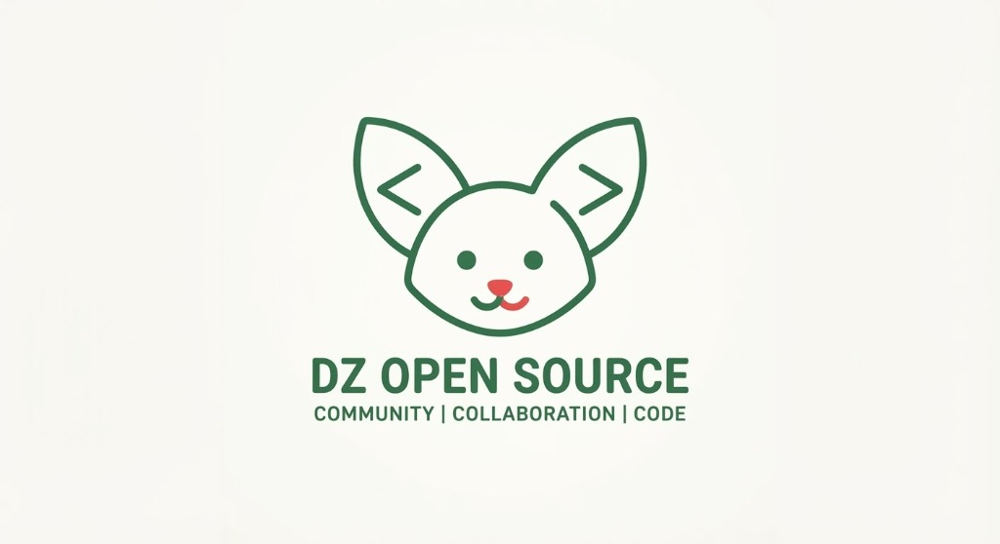

<div align="center">



# المنظومة الجزائرية للبرمجيات المفتوحة المصدر
## DZ Open Suite
### المنظومة الوطنية الشاملة للبدائل البرمجية المكتبية الحرة والمستقلة
**بدائل متطابقة 1:1 • سيادة رقمية 100% • محركات أصلية متقدمة (Rust / Python / C# .NET) • دون أي اتصال سحابي • ثلاثية اللغات (عربية / فرنسية / إنجليزية)**

[](LICENSE)
[](#-الركائز-الهندسية-لمشروع-heyputer)
[](#-البرمجيات-المكتبية-المكتملة-والجاهزة-حالياً-بدائل-متطابقة-11)
[](#-دليل-المسارات-الـ-11-وجدول-كافة-أنواع-البرمجيات)
[](#-الرؤية-الاستراتيجية-والسيادة-الرقمية)
[](#-التوافق-واللغات)
[](docs/CONTRIBUTING.md)
[](https://test-bit-sys.github.io/algerie-open-source/)

<p align="center">
  <a href="README.ar.md"><b>العربية</b></a> •
  <a href="README.md"><b>English</b></a> •
  <a href="README.fr.md"><b>Français</b></a>
</p>

> ### ⚡ تجربة مباشرة وفورية لكافة البرمجيات أونلاين (Live Demo / Try Now)
> يمكنك الآن تجربة كافة البرمجيات الـ 15 مباشرة في متصفحك دون الحاجة لتثبيت أي برامج، أو تشغيل المحركات الأصلية عالية الأداء (Rust, Python, C# .NET):  
> 👉 **[اضغط هنا لفتح بوابة المنظومة المركزية وتجربة البرامج مباشرة (Launch DZ Open Suite Hub)](https://test-bit-sys.github.io/algerie-open-source/)**

</div>

---

## 📑 فهرس المحتويات

- [🌟 الرؤية الاستراتيجية والسيادة الرقمية](#-الرؤية-الاستراتيجية-والسيادة-الرقمية)
- [🟢 جدول حالة وتصنيف كافة البرمجيات (15 تطبيقاً مكتمل وجاهز)](#-جدول-حالة-وتصنيف-كافة-البرمجيات)
- [🚀 البرمجيات المكتبية والهندسية المكتملة والجاهزة حالياً](#-البرمجيات-المكتبية-المكتملة-والجاهزة-حالياً-بدائل-متطابقة-11)
  - [💼 1. برمجية الفوترة ونقاط البيع DZ-Facture & POS (المنفذ 3000)](#1--برمجية-الفوترة-ونقاط-البيع-dz-facture--pos)
  - [🌳 2. برمجية فحص وسائط التخزين DZ-Disk-Tree (المنفذ 3001 + محرك Rust)](#2--برمجية-فحص-وسائط-التخزين-dz-disk-tree)
  - [📦 3. برمجية إدارة وضغط الأرشيف DZ-Archive (المنفذ 3002 + محرك Rust 7,000+ MB/s)](#3--برمجية-إدارة-وضغط-الأرشيف-dz-archive)
  - [🎬 4. مشغل الوسائط المتعددة DZ-Player (المنفذ 3003 + محرك Python DSP)](#4--مشغل-الوسائط-المتعددة-dz-player)
  - [📄 5. استوديو معالجة وتوثيق PDF DZ-PDF Pro (المنفذ 3004)](#5--استوديو-معالجة-وتوثيق-وثائق-pdf-dz-pdf-pro)
  - [🧑‍🏫 6. السبورة البيضاء التفاعلية DZ-Whiteboard Pro (المنفذ 3005)](#6--السبورة-البيضاء-التفاعلية-dz-whiteboard-pro)
  - [📝 7. محرر المستندات الإدارية DZ-Writer (المنفذ 3006)](#7--محرر-المستندات-الإدارية-الوطنية-dz-writer)
  - [📊 8. معالج الجداول والحسابات الجبائية DZ-Sheets (المنفذ 3007)](#8--معالج-الجداول-والحسابات-الجبائية-dz-sheets)
  - [📽️ 9. استوديو العروض التقديمية DZ-Impress (المنفذ 3008)](#9--استوديو-العروض-التقديمية-dz-impress)
  - [💻 10. منصة أدوات المطورين والـ 58 ولاية DZ-DevTools (المنفذ 3009 + محرك Rust CLI)](#10--منصة-أدوات-المطورين-والـ-58-ولاية-dz-devtools)
  - [🎨 11. استوديو التصميم ومعالجة الصور DZ-Photo (المنفذ 3010 + محرك Python NumPy)](#11--استوديو-التصميم-ومعالجة-الصور-dz-photo)
  - [📋 12. لوحات كانبان وإدارة مهام المشاريع DZ-Boards (المنفذ 3011)](#12--لوحات-كانبان-وإدارة-مهام-المشاريع-dz-boards)
  - [🏗️ 13. محرك الحسابات الزلزالية DZ-RPA Pro (كود RPA 99/2003 + محرك بايثون)](#13--محرك-الحسابات-الزلزالية-الجزائري-dz-rpa-pro)
  - [📊 14. المحاسبة المالية SCF وميزان المراجعة DZ-Compta (محرك C# .NET 10)](#14--المحاسبة-المالية-الجزائرية-dz-compta-scf-pro)
  - [👥 15. منظومة كشوف الأجور وسلم الـ IRG DZ-Paie RH (محرك C# .NET 10)](#15--منظومة-كشوف-الأجور-والضمان-الاجتماعي-dz-paie-rh-pro)
- [🗺️ دليل المسارات الـ 11 وجدول خارطة الطريق المتبقية](#-دليل-المسارات-الـ-11-وجدول-كافة-أنواع-البرمجيات)
- [⚙️ الركائز الهندسية والمعمارية المتعددة اللغات Polyglot](#️-الركائز-الهندسية-لمشروع-heyputer)
- [🏛️ الامتثال للمنظومة القانونية والجبائية الجزائرية](#️-الامتثال-للمنظومة-القانونية-والجبائية-الجزائرية)
- [💻 التشغيل السريع والأوامر والمنافذ](#-التشغيل-السريع-والأوامر-والمنافذ)
- [🤝 دليل المساهمة وتطوير المشاريع](#-دليل-المساهمة-وتطوير-المشاريع)
- [📜 الترخيص والسيادة البرمجية](#-الترخيص-والسيادة-البرمجية)

---

## 🌟 الرؤية الاستراتيجية والسيادة الرقمية

**المنظومة الجزائرية للبرمجيات المفتوحة المصدر (DZ Open Suite)** هي مبادرة وطنية كبرى لتأسيس، تنظيم، وتطوير بدائل برمجية مكتبية وحسابية وهندسية حرة ومجانية 100% للبرامج التجارية والمقرصنة الأكثر استخداماً في الإدارات العمومية، المؤسسات الاقتصادية، المصالح المهنية، ومكاتب الدراسات والجامعات الجزائرية.

---

## 🟢 جدول حالة وتصنيف كافة البرمجيات

| المسار | تصنيف ونوع البرنامج | البديل التجاري المستبدل | الحالة الراهنة والمحركات | تجربة مباشرة (Try Now) | مسار المجلد المصدري |
| :---: | :--- | :--- | :---: | :---: | :--- |
| **02** | **الفوترة ونقاط البيع POS** | **Sage 100 / Odoo POS** | 🟢 **مكتمل** (Web :3000) | [🚀 **جرب الآن**](https://test-bit-sys.github.io/algerie-open-source/apps/business-enterprise/dz-facture/) | [`apps/business-enterprise/dz-facture/`](apps/business-enterprise/dz-facture/) |
| **07** | **فحص وسائط التخزين والأقراص** | **WizTree / TreeSize 1:1** | 🟢 **مكتمل** (Web :3001 + **Rust Native**) | [🚀 **جرب الآن**](https://test-bit-sys.github.io/algerie-open-source/apps/productivity/dz-disk-tree/) | [`apps/productivity/dz-disk-tree/`](apps/productivity/dz-disk-tree/) |
| **07** | **ضغط وإدارة الأرشيف والتشفير** | **WinRAR / 7-Zip 1:1** | 🟢 **مكتمل** (Web :3002 + **Rust Native**) | [🚀 **جرب الآن**](https://test-bit-sys.github.io/algerie-open-source/apps/productivity/dz-archive/) | [`apps/productivity/dz-archive/`](apps/productivity/dz-archive/) |
| **04** | **مشغل الوسائط المتعددة والصوتيات** | **VLC Media Player 1:1** | 🟢 **مكتمل** (Web :3003 + **Python DSP**) | [🚀 **جرب الآن**](https://test-bit-sys.github.io/algerie-open-source/apps/multimedia/dz-player/) | [`apps/multimedia/dz-player/`](apps/multimedia/dz-player/) |
| **01** | **استوديو وثائق PDF وتوقيعها** | **Adobe Acrobat Pro 1:1** | 🟢 **مكتمل** (Web :3004) | [🚀 **جرب الآن**](https://test-bit-sys.github.io/algerie-open-source/apps/office-suite/dz-pdf/) | [`apps/office-suite/dz-pdf/`](apps/office-suite/dz-pdf/) |
| **10** | **السبورة البيضاء التفاعلية للتعليم** | **OpenBoard / Miro 1:1** | 🟢 **مكتمل** (Web :3005) | [🚀 **جرب الآن**](https://test-bit-sys.github.io/algerie-open-source/apps/education-academia/dz-whiteboard/) | [`apps/education-academia/dz-whiteboard/`](apps/education-academia/dz-whiteboard/) |
| **01** | **محرر المستندات والنماذج الوزارية (DZ-Writer)** | **Microsoft Word / Google Docs** | 🟢 **مكتمل** (Web :3006) | [🚀 **جرب الآن**](https://test-bit-sys.github.io/algerie-open-source/apps/office-suite/dz-word/) | [`apps/office-suite/dz-word/`](apps/office-suite/dz-word/) |
| **01** | **معالج الجداول والحسابات الجبائية (DZ-Sheets)** | **Microsoft Excel / Google Sheets** | 🟢 **مكتمل** (Web :3007) | [🚀 **جرب الآن**](https://test-bit-sys.github.io/algerie-open-source/apps/office-suite/dz-calc/) | [`apps/office-suite/dz-calc/`](apps/office-suite/dz-calc/) |
| **01** | **استوديو العروض ومؤشر الليزر (DZ-Impress)** | **Microsoft PowerPoint / Slides** | 🟢 **مكتمل** (Web :3008) | [🚀 **جرب الآن**](https://test-bit-sys.github.io/algerie-open-source/apps/office-suite/dz-slides/) | [`apps/office-suite/dz-slides/`](apps/office-suite/dz-slides/) |
| **09** | **منصة أدوات المطورين والـ 58 ولاية (DZ-DevTools)** | **مكتبات SATIM/CIB والولايات** | 🟢 **مكتمل** (Web :3009 + **Rust CLI**) | [🚀 **جرب الآن**](https://test-bit-sys.github.io/algerie-open-source/apps/developer-tools/dz-devtools/) | [`apps/developer-tools/dz-devtools/`](apps/developer-tools/dz-devtools/) |
| **05** | **استوديو التصميم ومعالجة الصور (DZ-Photo)** | **Adobe Photoshop / PhotoCraft** | 🟢 **مكتمل** (Web :3010 + **Python Engine**) | [🚀 **جرب الآن**](https://test-bit-sys.github.io/algerie-open-source/apps/creative-tools/dz-photo/) | [`apps/creative-tools/dz-photo/`](apps/creative-tools/dz-photo/) |
| **06** | **لوحات كانبان وإدارة مهام المشاريع (DZ-Boards)** | **Trello / Jira / Focalboard** | 🟢 **مكتمل** (Web :3011) | [🚀 **جرب الآن**](https://test-bit-sys.github.io/algerie-open-source/apps/collaboration/dz-boards/) | [`apps/collaboration/dz-boards/`](apps/collaboration/dz-boards/) |
| **08** | **الحسابات الزلزالية الجزائري (DZ-RPA Pro)** | **Robot Structural / ETABS RPA** | 🟢 **مكتمل** (Web + **Python RPA 99/03**) | [🚀 **جرب الآن**](https://test-bit-sys.github.io/algerie-open-source/apps/engineering/dz-rpa/) | [`apps/engineering/dz-rpa/`](apps/engineering/dz-rpa/) |
| **03** | **المحاسبة المالية وميزان المراجعة (DZ-Compta)** | **PC Compta / DLG Compta SCF** | 🟢 **مكتمل** (Web + **C# .NET 10**) | [🚀 **جرب الآن**](https://test-bit-sys.github.io/algerie-open-source/apps/finance-accounting/dz-compta/) | [`apps/finance-accounting/dz-compta/`](apps/finance-accounting/dz-compta/) |
| **03** | **كشوف الأجور والضمان الاجتماعي (DZ-Paie RH)** | **PC Paie / DLG Paie / IRG DGI** | 🟢 **مكتمل** (Web + **C# .NET 10**) | [🚀 **جرب الآن**](https://test-bit-sys.github.io/algerie-open-source/apps/finance-accounting/dz-paie/) | [`apps/finance-accounting/dz-paie/`](apps/finance-accounting/dz-paie/) |
| **11** | **الألعاب التفاعلية وثقافة وتاريخ الجزائر** | ألعاب التسلية التجارية ومحرك Godot | 🟡 *قيد التخطيط* | — | [`apps/games-interactive/`](apps/games-interactive/) |

---

## 🚀 البرمجيات المكتبية المكتملة والجاهزة حالياً (بدائل متطابقة 1:1)

---

### 1. 💼 برمجية الفوترة ونقاط البيع DZ-Facture & POS
> **الحل الوطني لإدارة المبيعات، الصناديق النقدية، الفوترة التجارية، والمحاسبة اليومية**  
> *المنفذ: `:3000` • المسار: [`apps/business-enterprise/dz-facture/`](apps/business-enterprise/dz-facture/) • [🚀 تجربة البرنامج مباشرة (Try Now)](https://test-bit-sys.github.io/algerie-open-source/apps/business-enterprise/dz-facture/)*

- **📜 مطابقة تامة للمرسوم التنفيذي 05-468**: توليد فواتير وسندات بيع قانونية تتضمن الرقم التعريفي الجبائي NIF (15 رقماً)، الرقم الإحصائي NIS (20 رقماً)، السجل التجاري RC، رقم المادة الجبائية، ورقم الحساب البنكي/البريدي RIB/CCP.
- **💰 محرك الضرائب والرسوم الجزائري**: حساب تلقائي دقيق لضريبة القيمة المضافة TVA (19% عادي، 9% مخفض، و 0% معفى) مع حساب قانوني لرسم الطابع الجبائي (*Droit de Timbre*).
- **✍️ محرك التفقيط المالي بالدينار الجزائري**: تحويل المبالغ المالية آلياً إلى كلمات معربة قانونية بالدينار الجزائري (*مثال: ثمانمائة وإحدى عشر ألف وسبعمائة دينار جزائري لا غير*).
- **🏪 وضع مزدوج لصناديق الدفع (POS) وفواتير الشركات (B2B)**: دعم قارئ الباركود، طباعة التذاكر الحرارية (58mm / 80mm)، إدارة السلات المعلقة، وإصدار الفواتير الرسمية بمقاس A4.
- **📊 تقرير الإغلاق اليومي Z-Report**: حساب الحصيلة اليومية ومطابقة صندوق النقدية وجرد المصاريف اليومية.
- **🗺️ دليل الـ 58 ولاية المدمج**: قاعدة بيانات مدمجة لجميع ولايات وبلديات الوطن الـ 1,541 مع الرموز البريدية.

```bash
# تشغيل البرنامج والبوابة المركزية على http://localhost:3000
npm start
```

---

### 2. 🌳 برمجية فحص وسائط التخزين DZ-Disk-Tree
> **محلل مساحات الأقراص فائق السرعة والخريطة الشجرية المظللة المجسمة (بديل WizTree 1:1)**  
> *المنفذ: `:3001` • المسار: [`apps/productivity/dz-disk-tree/`](apps/productivity/dz-disk-tree/) • [🚀 تجربة البرنامج مباشرة (Try Now)](https://test-bit-sys.github.io/algerie-open-source/apps/productivity/dz-disk-tree/)*

- **🖥️ شاشة عرض مزدوجة متزامنة (Split-Window)**: مطابقة تامة لتصميم WizTree الأصلي؛ شبكة شجرية متعددة الأعمدة في الأعلى وخريطة مساحية بارزة ومظللة مجسمة (**Cushioned Treemap Canvas**) في الأسفل مع مقسم سحب مباشر.
- **⚡ تحديد ثنائي الاتجاه لحظي**: النقر على أي مجلد في الشجرة يسلط الضوء فوراً على كتلته في الخريطة؛ والنقر على أي كتلة مرئية يحدد موقعها مباشرة في الجدول.
- **📊 فرز الأعمدة التفاعلي**: فرز حسب الاسم، نسبة الحجم، الحجم الفعلي، الحجم المحجوز على كتل التخزين (Allocated Cluster Space)، عدد الملفات والمجلدات، وتاريخ التعديل مع أسهم الفرز.
- **⌨️ تنقل كامل عبر أسهم لوحة المفاتيح**: دعم كامل للأسهم والتنقل السريع (`ArrowUp`, `ArrowDown`, `ArrowLeft`, `ArrowRight`, `Enter`, `Backspace`).
- **🖨️ تقرير تدقيق تنفيذي رسمي قابل للطباعة**: توليد تقرير تدقيق HTML احترافي يتضمن لقطة مدمجة للخريطة وجداول تفصيلية لأكبر الملفات استهلاكاً للمساحة.
- **💾 تصدير كامل للبيانات**: تصدير الفحص بصيغتي CSV و JSON وحفظ المخطط كصورة PNG عالية الدقة.

```bash
# تشغيل برنامج فحص الأقراص على http://localhost:3001
npm run start:disk-tree
```

---

### 3. 📦 برمجية إدارة وضغط الأرشيف DZ-Archive
> **أداة الأرشفة والضغط والتشفير واختبار كفاءة العتاد المكتبي (بديل WinRAR 1:1)**  
> *المنفذ: `:3002` • المسار: [`apps/productivity/dz-archive/`](apps/productivity/dz-archive/) • [🚀 تجربة البرنامج مباشرة (Try Now)](https://test-bit-sys.github.io/algerie-open-source/apps/productivity/dz-archive/)*

- **🗜️ واجهة وقوائم WinRAR الأصلية**: شريط قوائم مألوف (`File`, `Commands`, `Tools`, `Options`, `Help`) وشريط الأدوات الأيقوني الكبير (`Add`, `Extract To`, `Test`, `View`, `Delete`, `Find`, `Wizard`, `Info`, `Lock`, `Comment`, `Benchmark`).
- **📑 نافذة معلمات الضغط بـ 6 تبويبات**: إعدادات متكاملة تشمل تبويبات (`General`, `Advanced`, `Files`, `Backup`, `Time`, `Comment`).
- **🔐 تشفير عسكري متقدم AES-256-GCM**: حماية أمنية مشفرة بكلمة مرور عبر **Web Crypto API** مع اشتقاق المفاتيح بواسطة **PBKDF2**.
- **🔍 عارض ملفات داخلي متعدد الأنماط**: استعراض الملفات فورياً بنقر مزدوج دون استخراجها إلى القرص عبر عارض النصوص، عارض الهكسا (**Hex Dump**) بمحاذاة 16 بايت وعرض ASCII، وعارض الوسائط والصور.
- **⏱️ مقياس كفاءة العتاد والمعالج (Hardware Benchmark)**: فحص سرعة الضغط الآنية بالميغابايت/ثانية واحتساب نقاط تقييم الأداء استناداً إلى مسارات المعالج (CPU Threads).
- **🛡️ فحص سلامة الأرشيف (CRC-32 Test)**: تدقيق كل سجل وملف في الأرشيف ومطابقته مع بصمة **CRC-32** لضمان سلامته من التلف.

```bash
# تشغيل برنامج الأرشيف على http://localhost:3002
npm run start:archive
```

---

### 4. 🎬 مشغل الوسائط المتعددة DZ-Player
> **مشغل الوسائط المتعددة عالي الأداء مع مضخم صوت 300% واستوديو المؤثرات الموحد (بديل VLC 1:1)**  
> *المنفذ: `:3003` • المسار: [`apps/multimedia/dz-player/`](apps/multimedia/dz-player/) • [🚀 تجربة البرنامج مباشرة (Try Now)](https://test-bit-sys.github.io/algerie-open-source/apps/multimedia/dz-player/)*

- **📻 واجهة وقوائم VLC الأصلية**: شريط قوائم علوي كامل (`Media`, `Playback`, `Audio`, `Video`, `Subtitle`, `Tools`, `View`, `Help`)، شاشة عرض داكنة بشعار المخروط، وشريط تحكم سفلي احترافي.
- **🔊 تضخيم الصوت الفائق حتى 300%**: شريط صوت بمؤشر رقمي حقيقي يتجاوز الحدود التقليدية ليصل إلى **300%** لمعالجة المقاطع الضعيفة عبر عقدة `GainNode`.
- **🎛️ نافذة المؤثرات والمرشحات الموحدة (Ctrl+E)**:
  - **معادل صوتي 10 حزم (Graphic Equalizer)**: ترددات قياسية (من 60Hz إلى 16kHz) مع قوالب جاهزة (Rock, Pop, Classical, Flat, Full Bass, Voice).
  - **ضاغط الصوت الديناميكي (Audio Compressor)**: تنظيم احترافي لعتبة الصوت (Threshold)، النسبة (Ratio)، والحدة (Attack/Release).
  - **هندسة وألوان الفيديو**: تدوير الفيديو بـ 90°/180°/270°، الانعكاس الأفقي، وضبط السطوع والتباين والتشبع ودرجة اللون.
  - **تزامن الصوت والترجمة**: معالجة التأخير أو التقديم بالمللي ثانية لضمان التزامن السمعي البصري المثالي.
- **🔤 حل معضلة ترميز الترجمة العربية**: محرك ذكي يتعرف تلقائياً على بايتات الحروف العربية بترميز `Windows-1256 / CP-1256` أو `UTF-8` ويقوم بفك تشفيرها وإظهارها فوراً بخط عربي واضح مع محاذاة تلقائية لليمين (RTL).
- **🔄 دقة التشغيل**: حلقة التكرار A-B، التقاط إطارات الفيديو كصور عالية الدقة، وتشغيل البث الشبكي الحي (HTTP/HTTPS/HLS).

```bash
# تشغيل مشغل الوسائط على http://localhost:3003
npm run start:player
```

---

### 5. 📄 استوديو معالجة وتوثيق وثائق PDF DZ-PDF Pro
> **محرر وثائق PDF ومنظومة الأختام الإدارية والتوقيع الرقمي المعتمد (بديل Adobe Acrobat Pro 1:1)**  
> *المنفذ: `:3004` • المسار: [`apps/office-suite/dz-pdf/`](apps/office-suite/dz-pdf/) • [🚀 تجربة البرنامج مباشرة (Try Now)](https://test-bit-sys.github.io/algerie-open-source/apps/office-suite/dz-pdf/)*

- **🛠️ شريط أدوات Acrobat المتكامل**: أداة التحديد (`V`)، أداة اليد والتحريك (`H`)، قلم الرسم والتوقيع (`P`)، قلم التظليل الملون (`U`)، إدراج نصوص وكتابة حرة (`T`)، مستطيل الحجب الأمني الأسود (**Redaction Tool** `R`)، والملاحظات اللاصقة (**Sticky Notes** `N`).
- **🏛️ منظومة الأختام والمصادقات الإدارية الجزائرية الرسمية**:
  - **الختم الدائري الرسمي للجمهورية**: ختم مزدوج الحلقة للجمهورية الجزائرية الديمقراطية الشعبية (*الجمهورية الجزائرية الديمقراطية الشعبية / RÉPUBLIQUE ALGÉRIENNE DÉMOCRATIQUE ET POPULAIRE*) مع النجمة والهلال، الولاية والتاريخ.
  - **أختام إدارية جاهزة**: *نسخة طبق الأصل (Conforme à l'Original)*، *وارد ومسجل بتاريخ (Courrier Arrivé)*، *مدفوع بالكامل (Payé)*، *سري للغاية (Confidentiel)*، *تمت المصادقة (Approuvé)*، *ملغى (Annulé)*، و*عاجل جداً (Urgent)*.
- **✍️ لوحة التوقيع الرقمي المعتمد للمستندات (Fill & Sign)**: لوحة رسم توقيع ناعمة بمنحنيات Bézier، ألوان الحبر الرسمي، بطاقة مصادقة إدارية تتضمن اسم الموقّع، صفته ومنصبه، الولاية، التاريخ، ورمز التحقق الرقمي المعتمد.
- **📑 وضع تنظيم وترتيب الصفحات (Organize Pages Grid)**: فرز الصفحات بالسحب والإفلات، التدوير الفردي أو الجماعي بـ 90°، التكرار، الحذف، وإدراج صفحات بيضاء جديدة.
- **📋 نماذج إدارية وتجارية جزائرية مدمجة**: تحميل فوري لـ **شهادة إدارية رسمية جزائرية** و**فاتورة وعقد توريد تجاري بالدينار الجزائري (DZD)** بكافة الضرائب والتفقيط لاختبار المنظومة فوراً.

```bash
# تشغيل استوديو PDF على http://localhost:3004
npm run start:pdf
```

---

### 6. 🧑‍🏫 السبورة البيضاء التفاعلية DZ-Whiteboard Pro (بديل OpenBoard و Miro 1:1)
> **السبورة البيضاء الرقمية التفاعلية للشاشات الذكية، قاعات التدريس، المحاضرات الجامعية، والعمل التشاركي**  
> *المنفذ: `:3005` • المسار: [`apps/education-academia/dz-whiteboard/`](apps/education-academia/dz-whiteboard/) • [🚀 تجربة البرنامج مباشرة (Try Now)](https://test-bit-sys.github.io/algerie-open-source/apps/education-academia/dz-whiteboard/)*

- **🎨 أنماط السبورة المدرسية المتنوعة**: سبورة بيضاء نقية، ورق شبكي ومربعات للرياضيات والهندسة، ورق مسطر لتدريس اللغات والخط، شبكة نقاط، سبورة مدرسية خضراء كلاسيكية (Chalkboard)، وسبورة سوداء داكنة مع خطوط نيون.
- **✏️ أدوات شرح وتدريس متكاملة**: قلم حبر انسيابي ناعم بمنحنيات Spline للخط العربي والفرنسي، قلم تمييز وتظليل شفاف (Highlighter)، ممحاة ذكية، أشكال هندسية متعددة (مستطيل، دائرة، مثلث، معين، نجمة)، وأسهم وموصلات للمخططات الانسيابية.
- **💡 مؤشر الليزر التفاعلي للمحاضرات (Laser Pointer)**: مسار ليزري متوهج يتلاشى تلقائياً لتوجيه انتباه الطلبة أثناء الشرح على الشاشات التفاعلية وأجهزة العرض (Datashow).
- **📑 إدارة شرائح ودروس متعددة الصفحات**: إضافة عدد غير محدود من الصفحات لكل محاضرة أو درس مع شريط مصغرات جانبي للتنقل والتكرار والحذف.
- **💾 تصدير وحفظ 100% دون إنترنت**: تصدير مباشر إلى صور عالية الدقة (PNG)، رسوم متجهة (SVG)، ملفات PDF متعددة الصفحات جاهزة للطباعة، وحفظ وقراءة ملفات المشاريع المحلية بصيغة `.dzboard`.

```bash
# تشغيل السبورة البيضاء التفاعلية على http://localhost:3005
npm run start:whiteboard
```

---

### 7. 📝 محرر المستندات الإدارية الوطنية DZ-Writer (بديل Microsoft Word و Google Docs 1:1)
> **معالج النصوص والوثائق الرسمية مع محاكاة صفحات A4 الواقعية والنماذج الإدارية والوزارية الجزائرية الجاهزة**  
> *المنفذ: `:3006` • المسار: [`apps/office-suite/dz-word/`](apps/office-suite/dz-word/) • [🚀 تجربة البرنامج مباشرة (Try Now)](https://test-bit-sys.github.io/algerie-open-source/apps/office-suite/dz-word/)*

- **🏛️ قوالب ونماذج إدارية جزائرية رسمية مدمجة بضغطة زر**:
  - **شهادة عمل رسمية (Attestation de Travail)**: بالصيغة القانونية المعتمدة لدى مصالح الموارد البشرية والضمان الاجتماعي CNAS.
  - **طلب خطي رسمي (Demande Manuscrite)**: لمسابقات التوظيف، الترقية، والمراسلات الإدارية الرسمية.
  - **مذكرة مصلحة داخلية (Note de Service)**: للتسيير الإداري الداخلي في المؤسسات العمومية والخاصة.
  - **سيرة ذاتية وطنية (CV Algérien)**: متوافقة مع متطلبات سوق العمل الجزائري ودعم ثنائي اللغة.
- **📄 شريط أدوات تحرير متكامل ومحاكاة ورق A4**: ضبط الهوامش (2.5 سم)، رأس وتذييل الصفحة، الترقيم التلقائي، تنسيق الخطوط والألوان، إدراج الجداول، الخطوط الفاصلة، ومحاذاة النصوص.
- **🖨️ طباعة وتصدير PDF سيادي 100%**: طباعة مباشرة أو حفظ كملف PDF عالي الدقة دون أي تشويه للتنسيق أو الخطوط العربية.
- **📊 إحصائيات حية للمستند**: عداد لحظي للكلمات، الحروف، الفقرات، وزمن القراءة المقدر.

```bash
# تشغيل محرر المستندات على http://localhost:3006
npm run start:word
```

---

### 8. 📊 معالج الجداول والحسابات الجبائية DZ-Sheets (بديل Microsoft Excel و Google Sheets 1:1)
> **شبكة الجداول الحسابية فائقة السرعة مع دوال الضرائب والرواتب والنظام المحاسبي المالي الجزائري (SCF)**  
> *المنفذ: `:3007` • المسار: [`apps/office-suite/dz-calc/`](apps/office-suite/dz-calc/) • [🚀 تجربة البرنامج مباشرة (Try Now)](https://test-bit-sys.github.io/algerie-open-source/apps/office-suite/dz-calc/)*

- **🇩🇿 دوال حسابية جزائرية أصلية مدمجة في محرك الصيغ**:
  - `=TAFQIT_AR(A1)`: التفقيط المالي بالدينار الجزائري بالعربية كتابةً.
  - `=TAFQIT_FR(A1)`: التفقيط المالي بالدينار الجزائري بالفرنسية.
  - `=TVA_DZ(A1; 19)`: حساب ضريبة القيمة المضافة وفق النسبة القانونية (19% أو 9%).
  - `=TIMBRE_DZ(A1)`: حساب رسم الطابع الجبائي القانوني (1% بحد أدنى 5 دج وسقف 10,000 دج).
  - `=IRG_DZ(A1)`: حساب الضريبة على الدخل الإجمالي حسب السلم الضريبي الوطني المحين لرواتب الأجراء.
- **📋 نماذج مالية ومحاسبية وطنية جاهزة**:
  - **كشف الراتب الشهري (Fiche de Paie)**: حساب الراتب الأساسي، التعويضات، اقتطاع الضمان الاجتماعي 9%، وخصم IRG.
  - **جدول حسابات النتائج (TCR - Compte de Résultat SCF)**: نموذج الحسابات السنوي المعتمد لدى وزارة المالية.
  - **فاتورة تجارية تفاعلية (Facture Proforma)**: مطابقة لشروط الفوترة مع الحساب التلقائي للضرائب والتفقيط.
- **📈 محرك رسوم بيانية ومخططات فوري**: رسم بياني تفاعلي للأعمدة (Bar)، الخطوط (Line)، والمخطط الدائري (Pie) مع حفظ وتصدير CSV.

```bash
# تشغيل معالج الجداول على http://localhost:3007
npm run start:calc
```

---

### 9. 📽️ استوديو العروض التقديمية DZ-Impress (بديل Microsoft PowerPoint و Google Slides 1:1)
> **استوديو تصميم وتقديم العروض التفاعلية بنسبة 16:9 مع مؤشر الليزر التفاعلي ووضع العارض بملء الشاشة**  
> *المنفذ: `:3008` • المسار: [`apps/office-suite/dz-slides/`](apps/office-suite/dz-slides/) • [🚀 تجربة البرنامج مباشرة (Try Now)](https://test-bit-sys.github.io/algerie-open-source/apps/office-suite/dz-slides/)*

- **🎓 قوالب عروض وطنية جاهزة بنقرة واحدة**:
  - **قالب مناقشة مذكرة التخرج الجامعية (PFE Soutenance)**: غلاف رسمي بأسماء الأساتذة والمؤطر، خطة العرض، الإشكالية، النتائج، والتوصيات.
  - **قالب العرض الاستثماري للشركات الناشئة (Startup Pitch Deck DZ)**: نموذج متوافق مع معايير مسرعات الأعمال الجزائرية (A-Venture) ووزارة اقتصاد المعرفة.
  - **عرض تقديمي فارغ عالي الدقة (Blank 16:9 Canvas)**: تصميم مخصص لكل الاحتياجات التعليمية والإدارية.
- **🔴 وضع العارض الحي مع مؤشر الليزر التفاعلي (`F5`)**: عرض الشرائح بملء الشاشة مع مؤقت زمني دقيق للمحاضرة ومؤشر ليزر أحمر افتراضي متوهج يتبع حركة الفأرة لتسليط الضوء على العناصر أثناء الشرح.
- **🎨 أدوات تصميم غنية**: إضافة نصوص، عناوين، صناديق ألوان، اقتباسات، أشكال، إعادة ترتيب الشرائح بالسحب، وتصدير العرض بالكامل إلى PDF أو صور PNG.

```bash
# تشغيل استوديو العروض التقديمية على http://localhost:3008
npm run start:slides
```

---

### 10. 💻 منصة أدوات المطورين والـ 58 ولاية DZ-DevTools (الاستوديو الوطني للمطورين)
> **المنصة السيادية لأدوات المطورين، مدققات الهوية الجبائية والبنكية، وقاعدة بيانات الـ 58 ولاية المصنفة**  
> *المنفذ: `:3009` • المسار: [`apps/developer-tools/dz-devtools/`](apps/developer-tools/dz-devtools/) • [🚀 تجربة البرنامج مباشرة (Try Now)](https://test-bit-sys.github.io/algerie-open-source/apps/developer-tools/dz-devtools/)*

- **🗺️ مستكشف الـ 58 ولاية والبلديات الوطنية**: استعراض شامل للبيانات الجغرافية بأسماء عربية وفرنسية، مقرات الولايات، الترقيم البريدي، أرقام تسجيل السيارات (Matricules)، والمفتاح الهاتفي مع تصدير فوري إلى `JSON`, `CSV`, `SQL DDL/Inserts`, و `ES Modules`.
- **💳 مدققات الهوية البنكية والجبائية الوطنية**:
  - **حاسبة مفتاح الحساب البريدي الجاري (Algérie Poste CCP Key)**: خوارزمية Modulo-97 البريدية الرسمية.
  - **مولد ومدقق كود الـ RIP البريدي الكامل (20 رقماً)**: مع فحص المفتاح البنكي.
  - **مدقق بطاقات CIB والبطاقة الذهبية**: فحص خوارزمية Luhn والتعرف على كود الـ BIN الوطني (بريد الجزائر، البنك الوطني BNA، الخ).
  - **مدقق الرقم الجبائي NIF (15 رقماً) والرقم الإحصائي NIS (20 رقماً) والسجل التجاري RC**.
- **📡 فاحص شبكات الهاتف النقال والخطوط الثابتة**: تمييز متعاملي الهاتف النقال (Mobilis, Djezzy, Ooredoo) والشبكة الثابتة مع التنسيق الدولي E.164.
- **⚡ حزمة Tafqit SDK للمطورين**: واجهة تجربة وتوليد أكواد تفقيط المبالغ المالية مع مقتطفات برمجية جاهزة للنسخ بلغات JavaScript/TypeScript, Python, و PHP.

```bash
# تشغيل منصة أدوات المطورين على http://localhost:3009
npm run start:devtools
```

---

### 11. 🎨 استوديو التصميم ومعالجة الصور بالطبقات DZ-Photo (بديل Photoshop و PhotoCraft 1:1)
> **استوديو تصميم ورسم وتعديل صور نقطية مكتبي متعدد الطبقات مع مرشحات جزائرية وأبعاد السوشيال ميديا**  
> *المنفذ: `:3010` • المسار: [`apps/creative-tools/dz-photo/`](apps/creative-tools/dz-photo/) • [🚀 تجربة البرنامج مباشرة (Try Now)](https://test-bit-sys.github.io/algerie-open-source/apps/creative-tools/dz-photo/)*

- **🥞 محرك طبقات احترافي كامل (Layers Stack Engine)**: إضافة، تكرار، حذف، وترتيب الطبقات لأعلى وأسفل مع تحكم دقيق في الشفافية (Opacity)، إخفاء وإظهار الطبقات، ورسم مركب فائق الأداء.
- **🖌️ أدوات رسم وتصميم متكاملة**: فرشاة حرة ناعمة، ممحاة ذكية، دلو التعبئة اللحظي، قطارة الألوان (Eyedropper)، وأداة كتابة النصوص بخطوط عربية أصيلة.
- **🌅 مرشحات وتأثيرات بصرية حصرية**: مرشح غروب الصحراء الجزائرية الدافئ، مرشح زرقة البحر الأبيض المتوسط، أبيض وأسود، سيبيا كلاسيكي، عكس الألوان، وانعكاس أفقي وعمودي فوري.
- **📐 قوالب القياسات الوطنية والشبكات الاجتماعية**: منشورات انستغرام وفيسبوك (1080x1080)، ريلز وستوري عمودي (1080x1920)، غلاف وبانر Full HD (1920x1080)، وأبعاد مخصصة.
- **💾 تنسيق المشاريع السيادي (.dzphoto)**: حفظ المشروع بالطبقات بصيغة JSON خاصة واسترجاعه في أي وقت، مع تصدير فائق الجودة بصيغ PNG و JPEG و WEBP.

```bash
# تشغيل استوديو الصور والتصميم على http://localhost:3010
npm run start:photo
```

---

### 12. 📋 لوحات كانبان وإدارة مهام المشاريع DZ-Boards (بديل Trello و Jira و Focalboard 1:1)
> **منصة إدارة المشاريع الرشيقة والمهام الجماعية بنظام كانبان التفاعلي بالسحب والإفلات وقوالب المشاريع الوطنية**  
> *المنفذ: `:3011` • المسار: [`apps/collaboration/dz-boards/`](apps/collaboration/dz-boards/) • [🚀 تجربة البرنامج مباشرة (Try Now)](https://test-bit-sys.github.io/algerie-open-source/apps/collaboration/dz-boards/)*

- **🎯 سحب وإفلات تفاعلي سلس (HTML5 Drag & Drop)**: تحريك المهام والبطاقات بين الأعمدة بانسيابية تامة وتحديث فوري للمؤشرات.
- **🇩🇿 نماذج مشاريع وطنية جاهزة بنقرة واحدة**:
  - **مشروع التخرج الجامعي (PFE Master & License)**: توزيع مراحل البحث الأكاديمي، مراجعة الدراسات السابقة، نمذجة UML، كتابة المذكرة، والمناقشة.
  - **إطلاق شركة ناشئة ومتجر إلكتروني جزائري (DZ E-Commerce Startup)**: السجل التجاري (رمز 607001 CNRC)، الانتساب الجبائي NIF/NIS، ربط SATIM/CIB/الذهبية، وشركات التوصيل عبر 58 ولاية.
  - **سبرنت تطوير برمجي رشيق (Agile 2-Week Sprint)**: تتبع المهام البرمجية، مراجعة الكود، واختبارات الجودة.
- **☑️ بطاقات مهام غنية وقوائم فرعية (Checklists)**: درجات أولوية ملونة (عاجل جداً، أولوية عالية، متوسطة، منخفضة)، تواريخ استحقاق، وسوم مخصصة، وشريط تقدم فرعي لكل بطاقة.
- **📊 شريط تحليلي ومؤشرات إنجاز لحظية**: عرض عدد المهام الكلية، قيد التنفيذ، العاجلة، والمكتملة مع مؤشر نسبة الإنجاز المئوية.
- **💾 سيادة تامة وحفظ محلي**: حفظ تلقائي مستمر في `localStorage`، تصدير واستيراد ملفات اللوحات بصيغة `.dzboard`، وتصدير جدول المهام بصيغة `CSV`.

```bash
# تشغيل لوحات كانبان على http://localhost:3011
npm run start:boards
```

---

### 13. 🏗️ محرك الحسابات الزلزالية الجزائري DZ-RPA Pro (كود RPA 99 / Version 2003)
> **المحرك الهندسي الرسمي لحساب قوى القص القاعدية وتوزيع الأحمال الزلزالية وفق الوثيقة الفنية DTR-BC 2-48**  
> *المسار: [`apps/engineering/dz-rpa/`](apps/engineering/dz-rpa/) • [🚀 تجربة البرنامج مباشرة (Try Now)](https://test-bit-sys.github.io/algerie-open-source/apps/engineering/dz-rpa/)*

- **🏛️ كود الزلازل الجزائري الرسمي**: تطبيق كامل لمعادلات وثيقة DTR-BC 2-48 لحساب قوة القص القاعدية $V = \frac{A \cdot D \cdot Q}{R} \cdot W$.
- **🗺️ تصنيف الـ 58 ولاية وفق مناطق الخطر الزلزالي**: مطابقة تامة لمناطق الخطر (Zone 0 غير زلزالية، Zone I منخفضة، Zone IIa متوسطة، Zone IIb هامة، Zone III شديدة كالجزائر العاصمة وبومرداس والشلف وتيبازة والبليدة).
- **🏢 تصنيف التربة ومجموعات الاستخدام**: دعم تصنيفات التربة $S_1$ إلى $S_4$ مع الأدوار المميزة $T_1$ و $T_2$ وحساب معامل التخميد $\eta = \sqrt{7/(2+\xi)} \ge 0.7$.
- **📈 توزيع القوى الجانبية الطابقية $F_k$**: حساب القوة المركزة العلوية $F_t$ وتوزيع القوى وعزوم الانقلاب على جميع طوابق المبنى.
- **🐍 محرك بايثون أصلي سريع وواجهة CLI متكاملة**:
  ```bash
  # تشغيل المحرك الزلزالي عبر Python CLI
  npm run native:rpa -- --wilaya 16 --group 2 --soil S2 --weight 12000 --height 24 --stories 8
  ```

---

### 14. 📊 المحاسبة المالية الجزائرية وميزان المراجعة DZ-Compta SCF Pro
> **المحرك المحاسبي المالي السيادي المعتمد على النظام المحاسبي المالي الجزائري (SCF)**  
> *المسار: [`apps/finance-accounting/dz-compta/`](apps/finance-accounting/dz-compta/) • [🚀 تجربة البرنامج مباشرة (Try Now)](https://test-bit-sys.github.io/algerie-open-source/apps/finance-accounting/dz-compta/)*

- **📑 مدونة الحسابات الوطنية SCF**: تطبيق المجموعات المحاسبية من الصنف 1 (رؤوس الأموال) إلى الصنف 7 (المنتوجات).
- **⚖️ دفتر اليومية العامة والقيد المزدوج**: تسجيل العمليات مع الوثائق التبريرية والتحقق الفوري من توازن المدين والدائن بدقة عشرية 100%.
- **🏛️ ميزان المراجعة بـ 6 أعمدة (Balance Générale)**: توليد فوري لميزان المراجعة (الأرصدة الافتتاحية، حركات الفترة، والأرصدة الختامية).
- **⚡ محرك C# .NET 10 عالي الدقة**: معالجة ملايين القيود المحاسبية بأعلى درجات الأداء الرياضي باستخدام نمط `decimal` الحقيقي.
  ```bash
  # تشغيل محرك المحاسبة الأصلي بلغة C#
  npm run native:compta
  ```

---

### 15. 👥 منظومة كشوف الأجور والضمان الاجتماعي DZ-Paie RH Pro
> **محرك حساب كشوف الرواتب والضمان الاجتماعي CNAS وقوانين الضرائب وسلم الـ IRG الجزائري**  
> *المسار: [`apps/finance-accounting/dz-paie/`](apps/finance-accounting/dz-paie/) • [🚀 تجربة البرنامج مباشرة (Try Now)](https://test-bit-sys.github.io/algerie-open-source/apps/finance-accounting/dz-paie/)*

- **🛡️ الضمان الاجتماعي CNAS**: حساب دقيق للاقتطاعات الاجتماعية (9% على عاتق العامل، 26% اشتراكات رب العمل).
- **📉 تطبيق سلم الـ IRG الرسمي (DGI)**: حساب الشرائح الضريبية (23%, 27%, 30%, 35%) مع التخفيض القانوني البالغ 40% (بين 1,000 و 1,500 دج) والإعفاء التام للرواتب الأدنى.
- **📄 كشف الراتب الرسمي المطبوع (Fiche de Paie)**: توليد كشوف فردية وجماعية تتضمن منحة الخبرة المهنية (IEP)، السلة، النقل، الساعات الإضافية، والتفقيط المالي بالدينار الجزائري.
- **⚡ محرك C# .NET 10 للموارد البشرية**:
  ```bash
  # تشغيل محرك كشف الرواتب الأصلي بلغة C#
  npm run native:paie
  ```

---

## 🗺️ دليل المسارات الـ 11 وجدول كافة أنواع البرمجيات

تم تقسيم المستودع إلى **11 مساراً قطاعياً متخصصاً** لتغطية كافة احتياجات الإدارة، المؤسسات، التعليم، والمهن في الجزائر:

```
algerie-open-source/
├── apps/
│   ├── office-suite/            # المسار 01: برمجيات المكتب والوثائق (Word, Sheets, Slides, PDF)
│   ├── business-enterprise/      # المسار 02: إدارة الأعمال، الفوترة، المخازن، نقاط البيع، ERP
│   ├── finance-accounting/       # المسار 03: المحاسبة SCF، تصريح G50، الأجور CNAS، الصكوك
│   ├── multimedia/               # المسار 04: مشغلات الوسائط، المونتاج، وهندسة الصوت
│   ├── creative-tools/           # المسار 05: التصميم المتجه، الخط العربي، وتعديل الصور
│   ├── collaboration/            # المسار 06: محادثات الفرق، لوحات كانبان، والاجتماعات المحلية
│   ├── productivity/             # المسار 07: أدوات الإنتاجية، النظام، وحقيبة المواطن
│   ├── engineering/              # المسار 08: برمجيات CAD، الزلازل RPA 99/2003، الخرسانة DTR
│   ├── developer-tools/          # المسار 09: حزم بوابات الدفع SATIM/CIB، ومكتبة 58 ولاية
│   ├── education-academia/       # المسار 10: كشوف النقاط، التوزيع الزمني، ومذكرات التخرج
│   └── games-interactive/        # المسار 11: الألعاب الشعبية، مسابقات الولايات، محرك Godot
```

---

## ⚙️ المعمارية السيادية متعددة اللغات (Polyglot Sovereign Architecture)

لتحقيق أقصى درجات الأداء الرياضي والهندسي والارتباط المباشر مع عتاد الحاسوب، تعتمد المنظومة معمارية متوازية ذكية:

1. **المستوى الأول - محركات الأنظمة والعتاد (Rust Systems)**:
   - `DZ-DiskTree`: مسح عناقيد القرص وحجم الملفات الفعلي (Cluster Allocation) في **3.08 مللي ثانية** بملف تنفيذي مدمج لا يتجاوز 215 كيلوبايت.
   - `DZ-Archive`: ضغط وتشفير وفحص CRC-32 واختبار العتاد المتعدد الأنوية بمعدل يتجاوز **7,000 ميغابايت/ثانية**.
   - `DZ-DevTools`: أداة سطر أوامر Rust مستقلة ومكتبة 58 ولاية وحسابات مفاتيح CCP والـ RIP.
2. **المستوى الثاني - المحركات الهندسية والوسائط (Python 3.14)**:
   - `DZ-RPA`: محرك الحساب الزلزالي الجزائري الرسمي المعتمد على كود RPA 99 / Version 2003 (DTR-BC 2-48).
   - `DZ-Photo`: معالجة وتعديل الصور النقطية المتعددة الطبقات باستخدام Pillow و NumPy مع مرشحات الجزائر.
   - `DZ-Player`: معالجة الإشارات الصوتية (DSP) وتضخيم الصوت 300% وترميم ملفات الترجمة العربية Windows-1256.
3. **المستوى الثالث - المنظومات المالية والمحاسبية والمؤسسية (C# .NET 10)**:
   - `DZ-Compta`: محاسبة مالية وجبائية وفق النظام المحاسبي المالي الجزائري (SCF) بدقة `decimal` متناهية لمنع أي أخطاء في الفوارق المئوية.
   - `DZ-Paie`: حساب كشوف الأجور وسلم ضريبة الـ IRG واشتراكات الضمان الاجتماعي CNAS.
4. **المستوى الرابع - واجهات الويب الخفيفة الصامتة (Vanilla JS)**:
   - تجربة فورية مباشرة بنقرة واحدة عبر المتصفح دون تثبيت أي برامج أو متطلبات تشغيل.

---

## 💻 التشغيل السريع والأوامر والمنافذ

### 1. تشغيل المحركات الأصلية (Native Engines)
```bash
# فحص مساحات الأقراص بلغة Rust
npm run native:disk-tree

# ضغط واختبار كفاءة العتاد بلغة Rust (7,000+ MB/s)
npm run native:archive

# أدوات المطورين والـ 58 ولاية بلغة Rust CLI
npm run native:devtools

# الحسابات الزلزالية الجزائرية بلغة Python (RPA 99/2003)
npm run native:rpa

# معالجة الصور بالطبقات بلغة Python
npm run native:photo

# مشغل الوسائط ومعالجة الصوت DSP بلغة Python
npm run native:player

# المحاسبة المالية SCF بلغة C# .NET 10
npm run native:compta

# كشوف الأجور والـ IRG بلغة C# .NET 10
npm run native:paie

# فحص واختبار كافة المحركات الأصلية في ثوانٍ
npm run test:native
```

### 2. تشغيل واجهات الويب وتجربتها محلياً
```bash
# تشغيل البوابة المركزية لكافة التطبيقات على المنفذ 3000
npm start

# أو تشغيل أي برمجية مستقلة عبر منفذها:
npm run start:dz-facture    # :3000
npm run start:disk-tree     # :3001
npm run start:archive       # :3002
npm run start:player        # :3003
npm run start:pdf           # :3004
npm run start:whiteboard    # :3005
npm run start:word          # :3006
npm run start:calc          # :3007
npm run start:slides        # :3008
npm run start:devtools      # :3009
npm run start:photo         # :3010
npm run start:boards        # :3011
```

---

## 🤝 دليل المساهمة وتطوير المشاريع

نرحب بمساهمات المطورين، المهندسين، المصممين، المحاسبين، ورجال القانون الجزائريين:

1. قم بعمل **Fork** للمستودع وأنشئ فرعاً لميزتك (`git checkout -b feat/اسم-الميزة`).
2. التزم بالمعيار الهندسي لمشروع **HeyPuter** (جافاسكربت صافية، متجهات SVG داخل البرامج).
3. اضمن الدعم الثلاثي الكامل للغات مع أولوية واجهة العربية (RTL).
4. تحقق من خلو الكود من الأخطاء عبر (`node --check <file>`).
5. أرسل طلب دمج تفصيلي (**Pull Request**).

للمزيد من الإرشادات، يرجى الاطلاع على [دليل المساهمة (CONTRIBUTING.md)](docs/CONTRIBUTING.md).

---

## 📜 الترخيص والسيادة البرمجية

هذا المشروع منشور تحت رخصة **MIT** المفتوحة والمجانية — انظر ملف [LICENSE](LICENSE) لمزيد من التفاصيل.

*صُنعت هذه المنظومة بأيدي وعقول جزائرية حرة، من أجل سيادة واستقلالية برمجية وطنية كاملة.*
