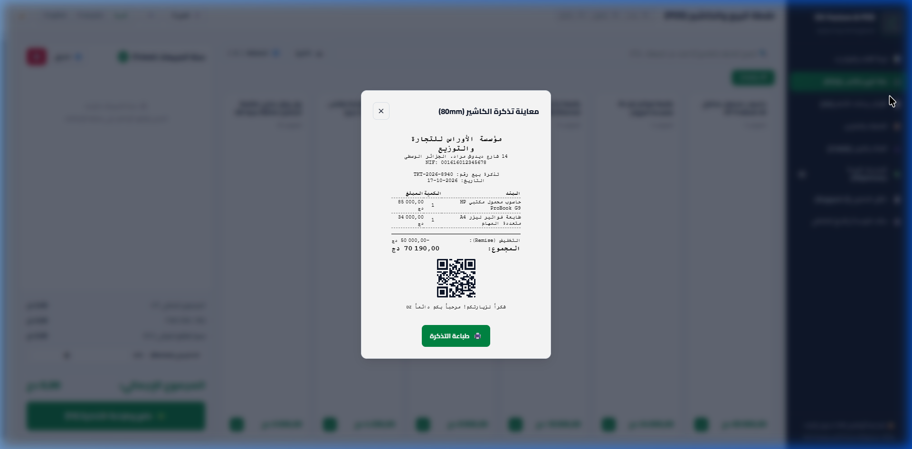
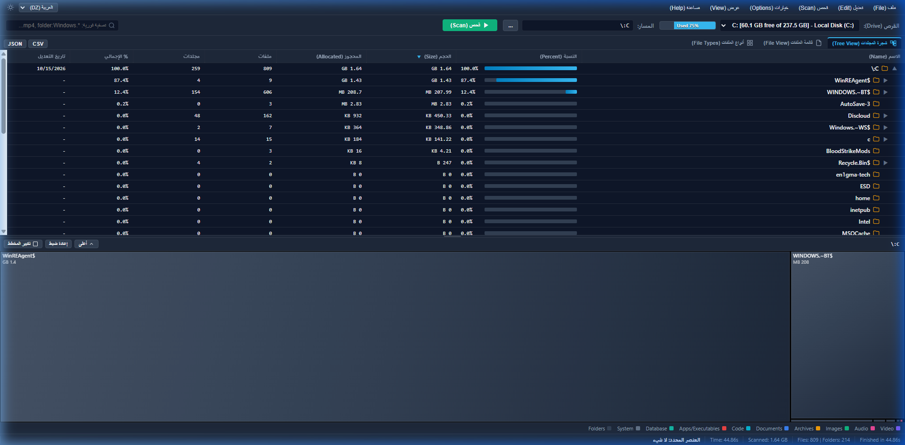
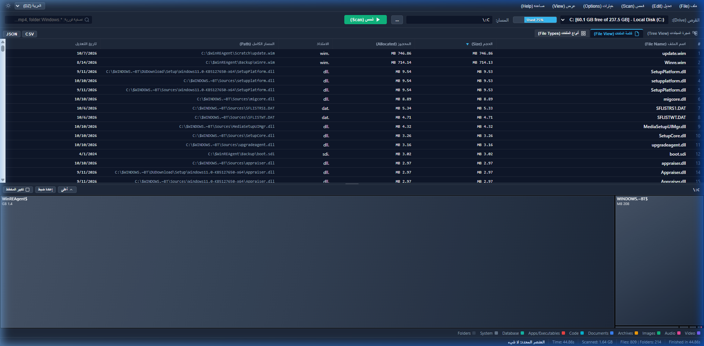
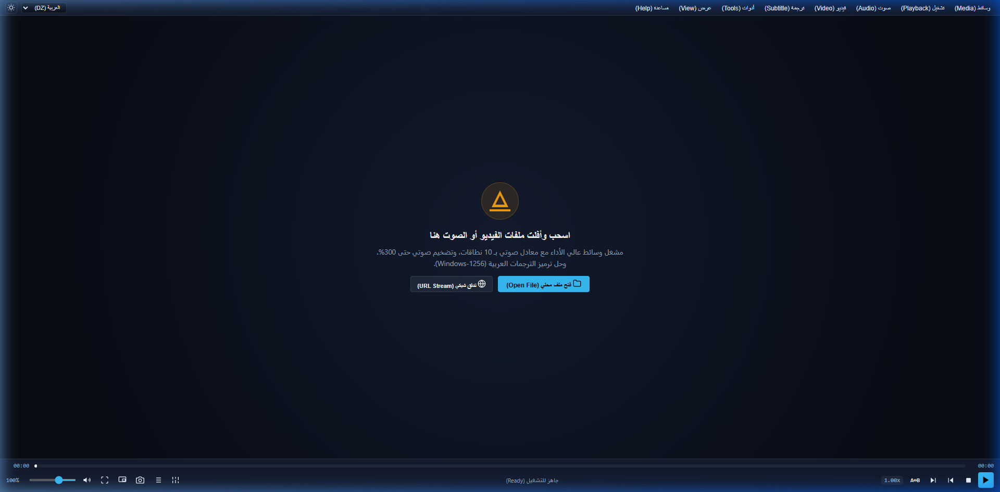
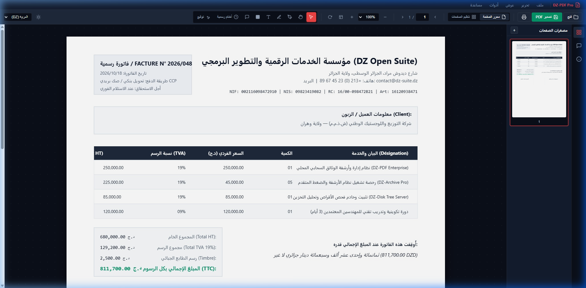

<div align="center">


# 🇩🇿 Écosystème Logiciel Open Source Algérien
## DZ Open Suite
### La Suite Logicielle Nationale de Bureau Souveraine, Libre & 100% Hors-Ligne
**Alternatives Natives 1:1 • Souveraineté Totale • Zéro Dépendance Cloud • Trilingue (AR / FR / EN)**

[](LICENSE)
[](#-principes-darchitecture-logicielle)
[](#-suite-logicielle-de-bureau-op%C3%A9rationnelle-alternatives-11-natives)
[](#-les-11-pôles-logiciels-stratégiques--matrice-complète)
[](#-mission-et-vision-stratégique)
[](#-internationalisation-et-bidirectionnalité)
[](docs/CONTRIBUTING.md)

<p align="center">
  <a href="README.fr.md"><b>🇫🇷 Français</b></a> •
  <a href="README.ar.md"><b>🇩🇿 العربية</b></a> •
  <a href="README.md"><b>🇬🇧 English</b></a>
</p>

</div>

---

## 📑 Table des Matières

- [🌟 Mission et Vision Stratégique](#-mission-et-vision-stratégique)
- [🟢 Matrice d'État et de Disponibilité des Logiciels](#-matrice-détat-et-de-disponibilité-des-logiciels)
- [🚀 Suite Logicielle de Bureau Opérationnelle (Alternatives 1:1 Natives)](#-suite-logicielle-de-bureau-opérationnelle-alternatives-11-natives)
  - [💼 1. DZ-Facture & POS (Alternative Sage / Odoo — Port 3000)](#1--dz-facture--pos-alternative-sage--odoo-pos)
  - [🌳 2. DZ-Disk-Tree (Alternative WizTree 1:1 — Port 3001)](#2--dz-disk-tree-alternative-wiztree-11)
  - [📦 3. DZ-Archive (Alternative WinRAR 1:1 — Port 3002)](#3--dz-archive-alternative-winrar-11)
  - [🎬 4. DZ-Player (Alternative VLC Media Player 1:1 — Port 3003)](#4--dz-player-alternative-vlc-media-player-11)
  - [📄 5. DZ-PDF Pro (Alternative Adobe Acrobat Pro 1:1 — Port 3004)](#5--dz-pdf-pro-alternative-adobe-acrobat-pro-11)
- [🗺️ Les 11 Pôles Logiciels Stratégiques & Matrice Complète](#-les-11-pôles-logiciels-stratégiques--matrice-complète)
- [⚙️ Principes d'Architecture Logicielle (Standard HeyPuter)](#️-principes-darchitecture-logicielle-standard-heyputer)
- [🏛️ Conformité Réglementaire et Fiscale Algérienne](#️-conformité-réglementaire-et-fiscale-algérienne)
- [💻 Démarrage Rapide et Référence des Ports](#-démarrage-rapide-et-référence-des-ports)
- [🤝 Guide de Contribution et Développement](#-guide-de-contribution-et-développement)
- [📜 Licence et Souveraineté](#-licence-et-souveraineté)

---

## 🌟 Mission et Vision Stratégique

**DZ Open Suite** est une initiative nationale souveraine d'envergure. Sa mission est de concevoir, maintenir et distribuer des alternatives logicielles de bureau 100% gratuites, open source et performantes, destinées à remplacer les outils propriétaires et fréquemment piratés utilisés dans les administrations publiques, entreprises économiques, hôpitaux, universités et commerces algériens.

### Pourquoi DZ Open Suite ?
1. **🛡️ Souveraineté Numérique Nationale** : Les actes administratifs officiels, pièces comptables, contrats commerciaux et dossiers de citoyens ne doivent jamais être hébergés sur des serveurs cloud tiers étrangers. Tous les calculs s'effectuent strictement en local (**100% Offline-First**).
2. **🚫 Éradication des Logiciels Piratés** : Remplacer définitivement les solutions dépassées (Visual Basic 6, Delphi 7, Access 2003) et les versions craquées par des logiciels modernes, sécurisés et auditables.
3. **🇩🇿 Conformité Rigoureuse aux Normes Algériennes** : Respect scrupuleux du Décret exécutif 05-468 (facturation commerciale), de la Loi 18-05 (commerce électronique), du SCF, de la TVA (19% et 9%), du droit de timbre fiscal, du tafqit en Dinars Algériens (DZD) et de l'apposition des tampons administratifs officiels.
4. **⚡ Standard d'Ingénierie HeyPuter** : Architecture en Vanilla JavaScript ES Modules, HTML5, CSS moderne, zéro framework externe lourd (ni React, ni Vue, ni Angular en production), zéro télémétrie, et utilisation de vecteurs SVG purs dans les applications.

---

## 🟢 Matrice d'État et de Disponibilité des Logiciels

| Pôle | Catégorie de Logiciel | Cible Propriétaire Remplacée | Statut | Port | Lien Opérationnel |
| :---: | :--- | :--- | :---: | :---: | :--- |
| **02** | **Facturation & Caisses POS** | **Sage 100 / Odoo POS** | 🟢 **Opérationnel** | `:3000` | [`apps/business-enterprise/dz-facture/`](apps/business-enterprise/dz-facture/) |
| **07** | **Analyseur d'Espace Disque** | **WizTree / TreeSize 1:1** | 🟢 **Opérationnel** | `:3001` | [`apps/productivity/dz-disk-tree/`](apps/productivity/dz-disk-tree/) |
| **07** | **Gestion d'Archives & Compression** | **WinRAR / 7-Zip 1:1** | 🟢 **Opérationnel** | `:3002` | [`apps/productivity/dz-archive/`](apps/productivity/dz-archive/) |
| **04** | **Lecteur Multimédia & Traitement** | **VLC Media Player 1:1** | 🟢 **Opérationnel** | `:3003` | [`apps/multimedia/dz-player/`](apps/multimedia/dz-player/) |
| **01** | **Studio PDF & Visa Administratif** | **Adobe Acrobat Pro 1:1** | 🟢 **Opérationnel** | `:3004` | [`apps/office-suite/dz-pdf/`](apps/office-suite/dz-pdf/) |
| **01** | **Bureautique (Texte, Tableur, Présentation)** | Microsoft 365 / Google Docs | 🟡 *Planifié* | — | [`apps/office-suite/`](apps/office-suite/) |
| **03** | **Comptabilité Financière & Paie SCF** | PC Compta, DLG Compta, PC Paie | 🟡 *Planifié* | — | [`apps/finance-accounting/`](apps/finance-accounting/) |
| **05** | **Création Graphique & Calligraphie** | Adobe Photoshop / Illustrator | 🟡 *Planifié* | — | [`apps/creative-tools/`](apps/creative-tools/) |
| **06** | **Messagerie d'Équipe & Collaboration** | Slack, Teams, Trello, Zoom | 🟡 *Planifié* | — | [`apps/collaboration/`](apps/collaboration/) |
| **08** | **Génie Civil & CAO Parasismique** | AutoCAD, Robot Structural, ETABS | 🟡 *Planifié* | — | [`apps/engineering/`](apps/engineering/) |
| **09** | **Passerelles Développeurs (SATIM/CIB)** | SDKs constructeurs fragmentés | 🟡 *Planifié* | — | [`apps/developer-tools/`](apps/developer-tools/) |
| **10** | **Enseignement Supérieur & Scolaire** | Bases Access obsolètes, FET | 🟡 *Planifié* | — | [`apps/education-academia/`](apps/education-academia/) |
| **11** | **Jeux du Patrimoine & Culture** | Jeux grand public commerciaux | 🟡 *Planifié* | — | [`apps/games-interactive/`](apps/games-interactive/) |

---

## 🚀 Suite Logicielle de Bureau Opérationnelle (Alternatives 1:1 Natives)

---

### 1. 💼 DZ-Facture & POS (Alternative Sage / Odoo POS)
> **Solution Nationale de Facturation Commerciale, Caisses Enregistreuses, Stocks & Moteur Fiscal**  
> *Port : `:3000` • Répertoire : [`apps/business-enterprise/dz-facture/`](apps/business-enterprise/dz-facture/)*

<div align="center">
  
</div>

- **📜 Conformité Rigoureuse au Décret Exécutif 05-468** : Émission de factures réglementaires intégrant NIF (15 chiffres), NIS (20 chiffres), Registre de Commerce (RC), Article d'Imposition et coordonnées bancaires/postales (RIB/CCP).
- **💰 Moteur Fiscal Algérien** : Calcul automatique de la TVA (19% normal, 9% réduit, 0% exonéré) et du droit de timbre fiscal avec plafonds légaux.
- **✍️ Moteur de Tafqit Monétaire** : Conversion des montants en toutes lettres en arabe juridique, français et anglais (*ex. Huit cent onze mille sept cents Dinars Algériens et zéro centime*).
- **🏪 Double Mode Caisse POS & Facturation B2B** : Scan code-barres rapide, impression de tickets de caisse thermiques (58mm/80mm), gestion des paniers en attente et factures A4 normalisées.
- **📊 Clôture Journalière (Z-Report)** : Arrêté de caisse journalier, audit des fonds de tiroir et suivi des menues dépenses.
- **🗺️ Base Complète des 58 Wilayas** : Répertoire intégré de l'ensemble des 58 wilayas et 1 541 communes avec codes postaux.

```bash
# Lancer le portail et DZ-Facture sur http://localhost:3000
npm start
```

---

### 2. 🌳 DZ-Disk-Tree (Alternative WizTree 1:1)
> **Analyseur Haute Vitesse d'Espace Disque & Treemap Cushioned 3D**  
> *Port : `:3001` • Répertoire : [`apps/productivity/dz-disk-tree/`](apps/productivity/dz-disk-tree/)*

<div align="center">
  
</div>

- **🖥️ Affichage Découpé Synchronisé (Split View)** : Arborescence hiérarchique détaillée en haut et Treemap biseauté (**Cushioned Treemap Canvas**) en bas avec séparateur redimensionnable par glisser-déposer.
- **⚡ Liaison Bidirectionnelle Instantanée** : Sélectionner un dossier dans l'arborescence zoome la carte géométrique ; cliquer sur un bloc sélectionne la ligne correspondante dans la table.
- **📊 Tri Multicolonne Interactif** : Tri immédiat par Nom, % Espace parent, Taille réelle, Espace alloué sur clusters (limite 4 Ko), Nombre de fichiers, Dossiers et Date de modification.
- **⌨️ Navigation Intégrale au Clavier** : Déplacement naturel dans l'arborescence (`ArrowUp`, `ArrowDown`, `ArrowLeft`, `ArrowRight`, `Enter`, `Backspace`).
- **🖨️ Rapport d'Audit Imprimable** : Génération d'un audit HTML autonome prêt à l'impression avec capture treemap intégrée et tableaux statistiques.
- **💾 Exportations Complètes** : Sauvegarde des scans en CSV et JSON ou capture PNG haute résolution.

```bash
# Lancer DZ-Disk-Tree sur http://localhost:3001
npm run start:disk-tree
```

---

### 3. 📦 DZ-Archive (Alternative WinRAR 1:1)
> **Compresseur Haute Performance, Chiffrement AES-256-GCM & Benchmark Matériel**  
> *Port : `:3002` • Répertoire : [`apps/productivity/dz-archive/`](apps/productivity/dz-archive/)*

<div align="center">
  
</div>

- **🗜️ Interface Iconique WinRAR** : Barre de menus complète (`Fichier`, `Commandes`, `Outils`, `Options`, `Aide`) et grande barre d'outils classique (`Ajouter`, `Extraire vers`, `Tester`, `Afficher`, `Supprimer`, `Rechercher`, `Assistant`, `Infos`, `Verrouiller`, `Commentaire`, `Benchmark`).
- **📑 Dialogue de Compression à 6 Onglets** : Paramétrage avancé via `Général`, `Avancé`, `Fichiers`, `Sauvegarde`, `Temps`, et `Commentaire`.
- **🔐 Chiffrement Cryptographique Robuste AES-256-GCM** : Sécurisation matérielle par mot de passe via l'API Web Crypto avec dérivation PBKDF2.
- **🔍 Visionneuse Interne Multi-Mode** : Visualisation instantanée sans extraction disque (Texte brut, Vidage hexadécimal 16 octets avec valeurs ASCII, Lecteur multimédia).
- **⏱️ Benchmark Matériel Intégré** : Évaluation du débit de compression (Mo/s) et indice de performance multi-cœur.
- **🛡️ Vérification d'Intégrité CRC-32** : Contrôle d'intégrité octet par octet pour garantir l'absence d'altération des données.

```bash
# Lancer DZ-Archive sur http://localhost:3002
npm run start:archive
```

---

### 4. 🎬 DZ-Player (Alternative VLC Media Player 1:1)
> **Lecteur Multimédia Avancé avec Amplification 300% & Studio d'Effets Unifié**  
> *Port : `:3003` • Répertoire : [`apps/multimedia/dz-player/`](apps/multimedia/dz-player/)*

<div align="center">
  
</div>

- **📻 Expérience VLC Authentique** : Menus supérieurs classiques, viewport vidéo sombre avec cône emblématique et barre de contrôle de lecture.
- **🔊 Super-Amplification Sonore jusqu'à 300%** : Pipeline audio via `GainNode` permettant de porter le volume à 300% avec jauge numérique en temps réel.
- **🎛️ Panneau Unifié des Effets et Filtres (Ctrl+E)** :
  - **Égaliseur Graphique 10 Bandes** : Fréquences de 60Hz à 16kHz avec profils préconfigurés (Rock, Pop, Classique, Plat, Pleines Basses, Voix).
  - **Compresseur Dynamique Audio** : Régulation de la dynamique (`DynamicsCompressorNode`) avec réglages de Seuil, Coude, Ratio, Attaque et Relâchement.
  - **Géométrie et Colorimétrie Vidéo** : Rotation en temps réel 90°/180°/270°, inversion miroir, luminosité, contraste, saturation et teinte.
  - **Synchronisation Précise** : Ajustement au millième de seconde des décalages temporels entre les pistes audio et les sous-titres.
- **🔤 Détection Automatique des Sous-Titres Arabes** : Détection intelligente des encodages `Windows-1256` et `UTF-8` pour corriger les caractères corrompus avec rendu RTL natif.
- **🔄 Contrôle de Lecture** : Boucle de répétition A-B, capture d'instantanés d'images (Snapshots HD), et flux réseau (HTTP/HTTPS/HLS).

```bash
# Lancer DZ-Player sur http://localhost:3003
npm run start:player
```

---

### 5. 📄 DZ-PDF Pro (Alternative Adobe Acrobat Pro 1:1)
> **Suite de Documents PDF, Tampons Administratifs Officiels & Signatures Numériques**  
> *Port : `:3004` • Répertoire : [`apps/office-suite/dz-pdf/`](apps/office-suite/dz-pdf/)*

<div align="center">
  
</div>

- **🛠️ Palette d'Outils Complète Acrobat** : Sélection (`V`), Main (`H`), Stylet (`P`), Surligneur (`U`), Texte (`T`), Masquage/Caviardage (**Redaction Tool** `R`), et Notes adhésives (**Sticky Notes** `N`).
- **🏛️ Sceau et Tampons Officiels Algériens** :
  - **Cachet Rond Officiel de la République** : Double anneau bilingue (*الجمهورية الجزائرية الديمقراطية الشعبية / RÉPUBLIQUE ALGÉRIENNE DÉMOCRATIQUE ET POPULAIRE*), étoile et croissant nationaux, Wilaya et date.
  - **Tampons Administratifs Réglementaires** : *Conforme à l'Original*, *Courrier Arrivé / Reçu le*, *Payé Intégralement*, *Strictement Confidentiel*, *Vu et Approuvé*, *Annulé et Non Avenu*, et *Très Urgent*.
- **✍️ Signature Numérique Certifiée (Fill & Sign)** : Pavé de signature vectoriel fluide, encres officielles (Bleu diplomatique, Noir bureau, Vert ministériel, Violet judiciaire) et carte d'authentification nominative avec fonction, Wilaya et empreinte de contrôle.
- **📑 Organiseur et Trieur de Pages** : Grille visuelle avec réorganisation par glisser-déposer, rotation individuelle ou collective à 90°, duplication, suppression et ajout de pages vierges.
- **📋 Modèles Administratifs et Commerciaux Intégrés** : Chargement immédiat d'une attestation administrative officielle et d'une facture/contrat commercial en DZD.

```bash
# Lancer DZ-PDF Pro sur http://localhost:3004
npm run start:pdf
```

---

## 🗺️ Les 11 Pôles Logiciels Stratégiques & Matrice Complète

Le monorepo DZ Open Suite est structuré en **11 pôles fonctionnels spécialisés** couvrant tous les secteurs administratifs, économiques et éducatifs en Algérie :

```
algerie-open-source/
├── apps/
│   ├── office-suite/            # Pôle 01: Bureautique (Texte, Tableur, Présentation, PDF)
│   ├── business-enterprise/      # Pôle 02: Facturation, Caisses POS, Stocks, ERP, CRM
│   ├── finance-accounting/       # Pôle 03: Comptabilité SCF, Déclarations G50, Paie CNAS
│   ├── multimedia/               # Pôle 04: Lecteurs multimédias, Montage NLE, Enregistrement
│   ├── creative-tools/           # Pôle 05: Graphisme vectoriel, Calligraphie, Retouche photo
│   ├── collaboration/            # Pôle 06: Messagerie d'équipe, Tableaux kanban locaux
│   ├── productivity/             # Pôle 07: Utilitaires système, Analyseurs disque, Kit citoyen
│   ├── engineering/              # Pôle 08: CAO/DAO, Calcul parasismique RPA 99/2003, Béton DTR
│   ├── developer-tools/          # Pôle 09: SDK Passerelles SATIM/CIB, CLI 58 Wilayas
│   ├── education-academia/       # Pôle 10: Bulletins scolaires, Plannings, Thèses LaTeX
│   └── games-interactive/        # Pôle 11: Jeux du patrimoine, Quiz des wilayas, Godot
```

### Détail des Domaines d'Activité :

| # | Pôle Spécialisé | Applications et Cibles Prévues | Solutions Propriétaires Remplacées | Statut |
| :-: | :--- | :--- | :--- | :---: |
| **01** | **🏢 Bureautique** | **DZ-PDF Pro** (Éditeur & visa PDF), Traitement de texte administratif, Tableur avec formules algériennes, Présentations. | Microsoft 365, Google Workspace, Adobe Acrobat Pro | 🟢 *PDF Prêt*<br>🟡 *Bureautique Planifiée* |
| **02** | **💼 Entreprise & Gestion** | **DZ-Facture & POS** (Facturation décret 05-468, caisses POS, stocks), ERP modulaire, Gestion clients CRM. | Sage 100, Delphi POS, Odoo Enterprise, SAP | 🟢 *Facture/POS Prêt*<br>🟡 *ERP Planifié* |
| **03** | **📊 Finance & Comptabilité** | Comptabilité financière SCF, Assistant de déclaration fiscale G50, Gestion de la paie CNAS (barème IRG), Mandats CCP. | PC Compta, DLG Compta, PC Paie | 🟡 *Planifié* |
| **04** | **🎬 Vidéo & Multimédia** | **DZ-Player** (Lecteur 1:1 VLC), Montage vidéo NLE accéléré, Moteur de sous-titrage arabe RTL, Enregistrement de tutoriels. | VLC, Adobe Premiere, CapCut, Camtasia | 🟢 *Lecteur Prêt*<br>🟡 *Montage Planifié* |
| **05** | **🎨 Graphisme & Création** | Retouche d'images matricielles, Calligraphie vectorielle arabe et tifinagh, Station audio multipiste, Outils prépresse. | Adobe Photoshop, Illustrator, Audition | 🟡 *Planifié* |
| **06** | **💬 Collaboration** | Messagerie d'équipe auto-hébergée locale, Tableaux de projets Kanban, Visioconférence WebRTC sans installation, Wiki d'entreprise. | Slack, Microsoft Teams, Trello, Zoom | 🟡 *Planifié* |
| **07** | **⚡ Productivité & Système** | **DZ-Disk-Tree** (Alternative WizTree), **DZ-Archive** (Alternative WinRAR), Formulaires citoyens (résidence, déclarations), Double calendrier. | WizTree, WinRAR, 7-Zip, Utilitaires propriétaires | 🟢 *Disque Prêt*<br>🟢 *Archive Prête* |
| **08** | **🏗️ Ingénierie & CAO** | Visualiseur et éditeur CAO 2D/3D, Calculateur parasismique algérien (**RPA 99/2003**), Béton armé (**DTR-BC 2.41**), SIG topographique. | AutoCAD, Robot Structural, ETABS | 🟡 *Planifié* |
| **09** | **💻 Outils Développeurs** | SDK unifié passerelle de paiement SATIM/CIB/BaridiMob, Passerelle SMS OTP multi-opérateurs, CLI 58 Wilayas. | Bibliothèques propriétaires fragmentées | 🟡 *Planifié* |
| **10** | **🎓 Éducation & Université** | Gestion scolaire, bulletins de notes primaires/secondaires, Générateur d'emplois du temps sans conflit, Modèles LaTeX de thèses. | Bases Access obsolètes, FET | 🟡 *Planifié* |
| **11** | **🎮 Jeux & Patrimoine** | Quiz éducatifs géographie et histoire des 58 Wilayas, Jeux traditionnels algériens (Ronda, Dama), Kits ressources Godot. | Jeux commerciaux grand public | 🟡 *Planifié* |

---

## ⚙️ Principes d'Architecture Logicielle (Standard HeyPuter)

Tous les modules du monorepo respectent scrupuleusement la charte technique **HeyPuter / everything** :

```
┌────────────────────────────────────────────────────────────────────────┐
│                        DZ Open Suite Monorepo                          │
├────────────────────────────────────────────────────────────────────────┤
│  Couche 1: APIs Web Natives (HTML5 Canvas 2D · Web Audio · Web Crypto) │
│  Couche 2: Modules ES JavaScript purs (Aucune étape de compilation)    │
│  Couche 3: Données et Stockage Local (100% Offline-First)              │
│  Couche 4: Système de Design Bidirectionnel (Arabe RTL natif)          │
│  Couche 5: Discipline Vectorielle (Icônes SVG pures dans les applis)   │
└────────────────────────────────────────────────────────────────────────┘
```

1. **⚡ Zéro Framework Externe Lourd** : Aucun framework lourd (ni React, ni Vue, ni Angular) au runtime. L'utilisation directe du DOM natif et des modules ES assure des démarrages instantanés et une pérennité sur plusieurs décennies.
2. **🔒 100% Hors-Ligne (Offline-First)** : Autonomie complète vis-à-vis des connexions réseau. Les logiciels fonctionnent sans interruption dans les zones reculées (antennes communales isolées, postes frontières, sites industriels).
3. **🌐 Prise en Charge Native de l'Arabe (RTL)** : L'arabe est traité en citoyen de premier ordre avec orientation naturelle de droite à gauche (RTL), complété par le français et l'anglais.
4. **🎨 Discipline Vectorielle Épurée** : Tous les symboles visuels et indicateurs sont tracés sous forme de vecteurs mathématiques SVG purs au sein des applications.

---

## 🏛️ Conformité Réglementaire et Fiscale Algérienne

DZ Open Suite a été développée en stricte conformité avec le cadre légal algérien :

- **📜 Décret Exécutif 05-468** : Fixe les conditions et modalités d'établissement de la facture, du bon de caisse et des documents commerciaux.
- **⚖️ Loi 18-05** : Encadre le commerce électronique, la contractualisation numérique et la signature électronique sur le territoire national.
- **💵 Réglementation Fiscale** :
  - Taux normal de TVA : **19%**
  - Taux réduit de TVA : **9%**
  - Droit de Timbre Fiscal : **1%** sur les règlements en espèces (minimum 5 DZD, maximum 10 000 DZD).
- **🗺️ Découpage Administratif Territorial** : Intégration exhaustive des **58 Wilayas** et **1 541 Communes** avec codes postaux et indicatifs téléphoniques administratifs.

---

## 💻 Démarrage Rapide et Référence des Ports

### Prérequis
- [Node.js](https://nodejs.org/) version 18.0.0 ou supérieure.
- Un navigateur web moderne (Chrome, Edge, Firefox, Brave, Safari).

### 1. Cloner le Dépôt
```bash
git clone https://github.com/test-bit-sys/algerie-open-source.git
cd algerie-open-source
```

### 2. Démarrer le Serveur Central de l'Écosystème (Port 3000)
```bash
npm start
```
Accédez à **[http://localhost:3000](http://localhost:3000)** pour utiliser le portail central et naviguer vers n'importe quelle application via `/apps/<pôle>/<application>/`.

### 3. Démarrer des Applications Dédiées de Manière Autonome
Chaque application peut être exécutée de manière totalement indépendante sur son propre port :

```bash
# 🌳 DZ-Disk-Tree (Alternative WizTree) sur http://localhost:3001
npm run start:disk-tree

# 📦 DZ-Archive (Alternative WinRAR) sur http://localhost:3002
npm run start:archive

# 🎬 DZ-Player (Alternative VLC) sur http://localhost:3003
npm run start:player

# 📄 DZ-PDF Pro (Alternative Adobe Acrobat) sur http://localhost:3004
npm run start:pdf
```

---

## 🤝 Guide de Contribution et Développement

Nous invitons chaleureusement les développeurs, ingénieurs, designers, comptables et juristes algériens à contribuer :

1. Effectuez un **Fork** du projet et créez une branche dédiée (`git checkout -b feat/votre-fonctionnalite`).
2. Respectez rigoureusement le **standard architectural HeyPuter** (Vanilla JS ES Modules, graphisme SVG pur dans les applications).
3. Assurez le support trilingue natif (Arabe RTL prioritaire, Français et Anglais).
4. Validez l'absence d'erreurs de syntaxe (`node --check <fichier>`).
5. Soumettez une **Pull Request** détaillée décrivant vos apports.

Pour plus de précisions, consultez le [Guide de Contribution (CONTRIBUTING.md)](docs/CONTRIBUTING.md).

---

## 📜 Licence et Souveraineté

Ce projet est distribué sous **Licence MIT** — consultez le fichier [LICENSE](LICENSE) pour plus d'informations.

*🇩🇿 DZ Open Suite est conçue par et pour la nation et communauté algérienne, avec fierté, rigueur et indépendance technologique totale.*
