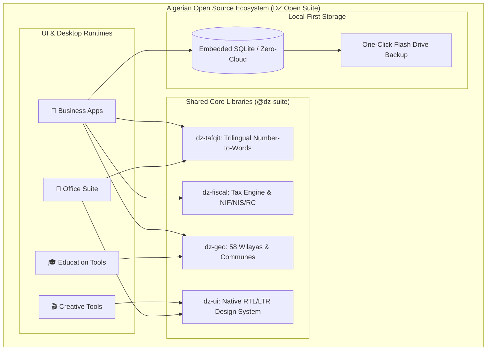

<p align="center">
  
</p>

<h1 align="center">🇩🇿 Algerian Open Source Software Ecosystem</h1>
<h3 align="center">DZ Open Suite — Modern, Free & Localized Software for Algeria</h3>

<p align="center">
  <a href="README.md"><b>English</b></a> •
  <a href="README.ar.md"><b>العربية</b></a> •
  <a href="README.fr.md"><b>Français</b></a>
</p>

<p align="center">
  <a href="https://github.com/test-bit-sys/algerie-open-source/blob/main/LICENSE"></a>
  <a href="#"></a>
  <a href="#"></a>
  <a href="#"></a>
  <a href="https://github.com/test-bit-sys/algerie-open-source/pulls"></a>
</p>

---

## 🌟 Vision & Mission

**DZ Open Suite** is a unified national open-source initiative engineered to provide high-performance, privacy-respecting, and 100% free software alternatives to the legacy proprietary and pirated tools commonly used across Algerian enterprises, schools, media studios, and public administrations.

By designing from scratch with the **Algerian economic, legal, and linguistic ecosystem** in mind, this project aims to foster local tech sovereignty, eliminate dependence on expensive recurring subscriptions, and empower Algerian developers and creators.

---

## 🗺️ Software Categories & Track Roadmap

The ecosystem is structured into **5 specialized tracks**, systematically replacing commercial and cracked software:

```
algerie-open-source/
│
├── 📁 apps/
│   ├── 🏢 01-business-management/    # Invoicing, Accounting (SCF), Payroll (CNAS), Inventory
│   ├── 🎬 02-creative-multimedia/      # Video Editing (Montage), Graphic Design, Audio Engineering
│   ├── 📝 03-office-productivity/      # Word Processor, Spreadsheets, PDF Tools, Presentations
│   ├── 🎓 04-education-academia/       # School Grading, Timetable Generation, University Thesis
│   └── 🛠️ 05-system-utilities/         # Postal (CCP) Slips, Administrative Forms, Postal Directory
│
├── 📁 packages/                        # Reusable Core Calculation Engines
│   ├── dz-tafqit/                      # Trilingual number-to-words currency engine (DZD)
│   ├── dz-fiscal/                      # NIF / NIS / RC / CCP validators & tax computation
│   ├── dz-geo/                         # Official 58 Wilayas & postal code lookup
│   └── dz-ui/                          # Bidirectional RTL/LTR UI component design system
│
└── 📁 docs/                            # Algerian legal, tax, and architectural specifications
```

---

## 📊 Comprehensive Software Matrix

| Track | Planned Tool | Target Proprietary Tool | Key Algerian Specifics |
| :--- | :--- | :--- | :--- |
| **🏢 Business** | `dz-facture` | Sage, Delphi POS, pirated cash registers | Executive Decree 05-468 A4 invoices, 1% cash stamp duty, 80mm receipt printers. |
| **🏢 Business** | `dz-compta` | PC Compta, DLG | Financial Accounting System (SCF), Bilan, TCR, G50 tax preparation. |
| **🏢 Business** | `dz-paie` | PC Paie | Progressive IRG brackets, CNAS contributions (9% / 26%), ATS documents. |
| **🎬 Creative** | `dz-video` | Adobe Premiere Pro, CapCut PC | Non-linear video editor with native RTL Arabic subtitles (no broken/reversed letters). |
| **🎬 Creative** | `dz-photo` | Adobe Photoshop, Canva | Raster & vector editing with Algerian social media and billboard presets. |
| **🎬 Creative** | `dz-audio` | Adobe Audition, FL Studio | Multi-track podcast mastering, noise reduction, and voiceover leveling. |
| **📝 Office** | `dz-docs` | Microsoft Word | Bi-directional Arabic-French typing engine, Algerian ministerial document templates. |
| **📝 Office** | `dz-sheets` | Microsoft Excel | Native Algerian formulas (`=TAFQIT_AR()`, `=TVA_DZ()`, `=TIMBRE_DZ()`). |
| **📝 Office** | `dz-pdf` | Adobe Acrobat Pro, iLovePDF | 100% offline PDF merger, digital signature, and administrative form filler (S12). |
| **🎓 Education** | `dz-school` | Legacy Access databases | Grading system, coefficients, quarterly report cards (Bulletins de notes). |
| **🎓 Education** | `dz-schedule` | FET, manual scheduling | Automated classroom & teacher timetable generation with zero clashes. |
| **🛠️ Utilities** | `dz-ccp-tool` | Manual handwriting | Automatic printing of official postal checks and CCP payment slips. |

---

## 🏛️ System Architecture



---

## 📦 Verified Core Packages

All shared calculation engines are standalone, dependency-free, and tested with **100% test coverage**:

```bash
# Run the entire test suite across all packages
npm test
```

* **`@dz-suite/tafqit`**: Converts financial numbers to words in **Arabic**, **French**, and **English** with legal anti-fraud suffixes.
* **`@dz-suite/fiscal`**: Validates **NIF (15 digits)**, **NIS (20 digits)**, **RC**, and **CCP check digit**, and computes VAT (19% & 9%) and cash stamp duty (1%).
* **`@dz-suite/geo`**: Full dataset of all **58 Algerian Wilayas** with multi-lingual search.

---

## 🤝 Contributing

We welcome software developers, legal experts, certified accountants, teachers, and graphic designers to contribute to this national initiative!

1. Explore the track directories under [`apps/`](apps/).
2. Review our [Contributing Guide](docs/CONTRIBUTING.md).
3. Open a Pull Request or file an issue to join the effort.

---

## 📜 License

This project is licensed under the **MIT License** — free to use, modify, and distribute for personal and commercial purposes.
