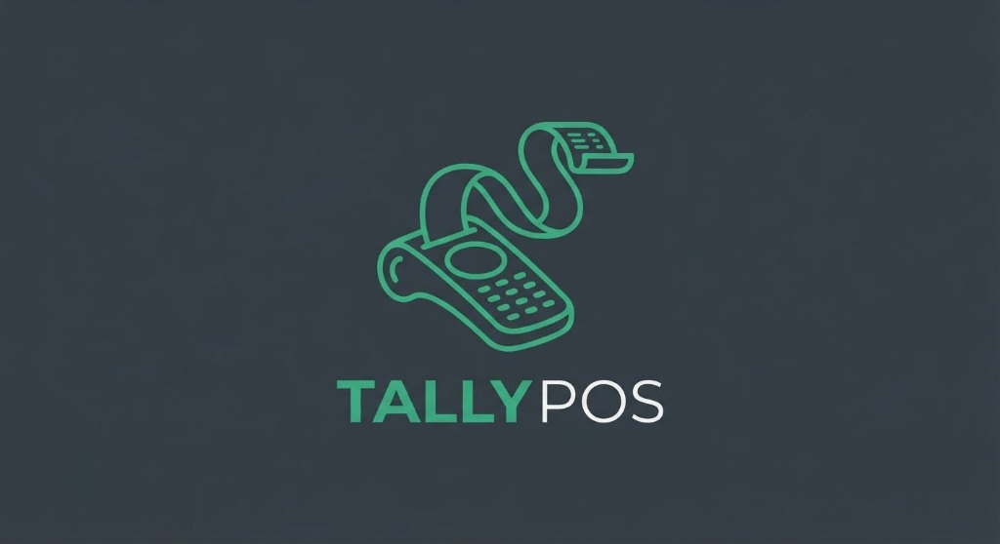

<p align="center">
  
</p>

# 🇩🇿 DZ-Facture & POS (نظام الفوترة ونقاط البيع الجزائري)

[](#)
[](https://opensource.org/licenses/MIT)
[](#)
[](#)
[](#)

نظام متكامل واحترافي مجاني ومفتوح المصدر للفوترة، نقاط البيع السريعة (POS الكاشير)، إدارة المخزون، والعملاء، مصمم خصيصاً ليتوافق بنسبة 100% مع القوانين الجبائية والتجارية الجزائرية وتفاصيل السوق الجزائري.

---

## 🌟 الميزات الرئيسية (Key Features)

### 1. الامتثال التام للقانون التجاري والجبائي الجزائري (Fiscal Compliance)
- **المرسوم التنفيذي 05-468**: طباعة فواتير A4 مطابقة تماماً للمواصفات القانونية الرسمية وتتضمن كافة البيانات الإلزامية:
  - **NIF** (رقم التعريف الجبائي - 15 رقماً مع التحقق الحسابي).
  - **NIS** (رقم التعريف الإحصائي).
  - **RC** (السجل التجاري الجزائري).
  - **AI** (رقم المادة الجبائية - Article d'Imposition).
  - **RIB / CCP** (رقم الحساب البنكي أو البريدي مع حساب المفتاح Clé تلقائياً).
- **الضريبة على القيمة المضافة (TVA)**: دعم كامل لمعدلات 19%، 9%، و 0% مع حساب الإجماليات HT و TTC.
- **رسم الطابع الجبائي (Timbre Fiscal)**: احتساب تلقائي ودقيق للرسم الإلزامي (1% من إجمالي الفاتورة في حالة الدفع نقداً / Espèces) مع إعفائه التلقائي عند الدفع بالشيك أو التحويل البنكي.
- **محرك التفقيط المالي (DZD Tafqit Engine)**: تحويل تلقائي للمبالغ المالية إلى حروف باللغات الثلاث (العربية: "فقط ... دينار جزائري وسنتيم لا غير"، الفرنسية: "Arrêté la présente facture à la somme de...", والإنجليزية) لمنع التزوير.

### 2. نقطة البيع السريع (POS & Thermal Receipt 80mm)
- شاشة كاشير سريعة مجهزة للعمل مع ماسحات الباركود وشاشات اللمس.
- دعم اختصارات لوحة المفاتيح والبحث الفوري عن المنتجات.
- طباعة تذاكر كاشير حرارية مقاس 80 مم تحوي تفاصيل الفاتورة، رمز الاستجابة السريع (QR-Code)، ومعلومات المحل.

### 3. العمل بدون إنترنت 100% (Offline-First) والنسخ الاحتياطي
- جميع البيانات (المنتجات، الفواتير، العملاء، الإعدادات) تُحفظ محلياً في المتصفح / الجهاز.
- زر تصدير فوري لقاعدة البيانات الكاملة بصيغة JSON لحفظها على قرص فلاش USB (Flash Disk) بضغطة زر.
- استرجاع فوري للبيانات من أي نسخة احتياطية دون فقدان أي سجل.

### 4. واجهة ثلاثية اللغات (AR / FR / EN)
- تبديل فوري بنقرة واحدة بين العربية (RTL كامل)، الفرنسية، والإنجليزية.
- دعم الوضع المظلم (Dark Mode) والوضع الفاتح الأنيق.

---

## 🚀 طريقة التشغيل (Quick Start)

### المتطلبات
- لا يتطلب أي قواعد بيانات خارجية أو حزم معقدة. يكفي وجود **Node.js** مثبت في الجهاز (أو فتح ملف `index.html` مباشرة).

### التشغيل عبر سطر الأوامر:
```bash
# الانتقال لمجلد البرنامج
cd apps/business-enterprise/dz-facture

# تشغيل الخادم
npm start
```
أو من المجلد الرئيسي للمستودع:
```bash
npm start
```

ثم افتح الرابط التالي في أي متصفح:
👉 **`http://localhost:3000`**

---

## 📁 بنية المشروع (Architecture)

```text
dz-facture/
├── index.html           # واجهة المستخدم الرئيسية والشاشات الست وقوالب الطباعة
├── server.js            # خادم محلي خفيف فائق السرعة بدون مكتبات خارجية
├── package.json         # تعريف التطبيق وإعدادات التشغيل
├── README.md            # التوثيق الشامل
└── src/
    ├── app.js           # منسق التطبيق، الأحداث، والتحكم ثلاثي اللغات
    ├── styles.css       # نظام التصميم، الوضع الليلي، وأنماط طباعة A4 و 80mm
    └── modules/
        ├── tafqit.js    # محرك التفقيط بالدينار الجزائري (عربي / فرنسي / إنجليزي)
        ├── fiscal.js    # محرك الحسابات الجبائية (TVA، الطابع 1%، فحص NIF/NIS)
        ├── geo.js       # قاعدة بيانات الـ 58 ولاية جزائرية
        └── db.js        # محرك التخزين المحلي والنسخ الاحتياطي للـ USB
```

---

## 🤝 المساهمة والتطوير (Contributing)
المشروع مفتوح بالكامل لمطوري الجزائر ومتاح تحت ترخيص MIT:
1. إضافة قارئ الباركود عبر كاميرا الويب.
2. دعم التغليف المكتبي كملف `.exe` و `.deb` عبر Tauri أو Electron.
3. الترحيب بفتح Pull Requests و Issues على مستودع المشروع الرئيسي.
