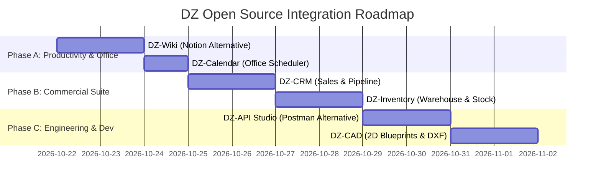

# DZ Open Source — Comprehensive Integration Plan & Strategic Roadmap

> **Document Version:** 1.0.0  
> **Status:** Awaiting User Review & Approval  
> **Date:** October 2026  
> **Architect:** Senior Software Architect & Open Source Integration Engineer

---

## 1. Architectural Strategy & Ground Rules

This plan outlines the systematic, professional integration of high-impact open-source applications into **DZ Open Source**, strictly adhering to the **Reuse before Build** philosophy.

### Core Operating Principles

1. **Non-Destructive Integration:** No existing application, test, or asset in `algerie-open-source` will be removed or altered without explicit prior authorization.
2. **Strict Licensing Verification:** Every integrated file retains original copyright notices, verified under MIT, Apache-2.0, or ISC licenses, and registered in `THIRD_PARTY_LICENSES`.
3. **100% Offline Data Sovereignty:** All remote cloud calls, external telemetry, third-party CDNs, and `*.puter.com` endpoints are permanently stripped or redirected to the local `dz-runtime.js` bridge.
4. **First-Class Trilingual & RTL Experience:** All integrated apps must support Arabic (RTL, Cairo font), French (LTR), and English (LTR), themed in accordance with the national green/white/slate design system.
5. **Atomic, Isolated Branches:** Each application integration will be developed on an isolated branch (`feat/integrate-<name>`), verified via test suites, and documented before progression.

---

## 2. Priority Phasing & Effort Estimation



### Detailed Component Prioritization Table

| Milestone | Component | Source Repository | Target Category | Integration Strategy | Estimated Effort | Impact Score |
| :---: | :--- | :--- | :--- | :--- | :---: | :---: |
| **01** | **DZ-Wiki** | `HeyPuter/everything/src/wiki` | `apps/productivity/dz-wiki` | Clean Vendoring + `dz-runtime` bridge | **Medium (2-3 hrs)** | 9.8 / 10 |
| **02** | **DZ-Calendar** | `HeyPuter/everything/src/calendar` | `apps/collaboration/dz-calendar` | Clean Vendoring + zero-deps adapt | **Low (1-2 hrs)** | 9.2 / 10 |
| **03** | **DZ-CRM** | `HeyPuter/everything/src/crm` | `apps/business-enterprise/dz-crm` | Clean Vendoring + DZD Currency | **Medium (2-3 hrs)** | 9.6 / 10 |
| **04** | **DZ-Inventory** | `HeyPuter/everything/src/inventory`| `apps/business-enterprise/dz-inventory` | Clean Vendoring + Barcode Scanner | **Medium (2-3 hrs)** | 9.4 / 10 |
| **05** | **DZ-API Studio** | `HeyPuter/everything/src/api-client`| `apps/developer-tools/dz-api` | Clean Vendoring + CodeMirror | **Medium (2-3 hrs)** | 9.0 / 10 |
| **06** | **DZ-CAD 2D** | `HeyPuter/everything/src/cad` + `dxf-parser` | `apps/engineering/dz-cad` | Clean Vendoring + DXF AST Parser | **High (3-4 hrs)** | 8.8 / 10 |

---

## 3. Step-by-Step Integration Protocol (Per Component)

Every component execution will strictly follow the 9-step quality gate:

```mermaid
flowchart LR
    Branch["1. Git Branch<br/>(feat/integrate-name)"] --> Clean["2. Vendor Clean Code<br/>(Strip Puter cloud URLs)"]
    Clean --> Bridge["3. Connect dz-runtime<br/>(IndexedDB & Sovereign Bar)"]
    Bridge --> I18n["4. RTL & Trilingual<br/>(Arabic, French, English)"]
    I18n --> Route["5. Server & Hub<br/>(server.js & index.html)"]
    Route --> Test["6. Run Tests<br/>(node --test & syntax checks)"]
    Test --> License["7. Update Licenses<br/>(THIRD_PARTY_LICENSES)"]
    License --> Commit["8. Conventional Commit<br/>& User Walkthrough"]
```



### Detailed Checklist for Each Step:

1. **Branch Creation:**
   ```bash
   git checkout -b feat/integrate-<component-name>
   ```
2. **Sanitization & Vendoring:**
   - Copy only necessary application files into `apps/<track>/<component-name>/`.
   - Strip all hardcoded references to `*.puter.com`, cloud authentication prompts, and third-party tracking scripts.
3. **Runtime Integration:**
   - Inject `<script src="/packages/dz-runtime/dz-runtime.js"></script>` and `<link rel="stylesheet" href="/packages/dz-runtime/dz-runtime.css">`.
   - Verify local IndexedDB persistence for all notes, deals, items, or requests.
4. **Localization & Algerian Aesthetics:**
   - Ensure RTL support (`dir="rtl"`) with `Cairo` font for Arabic.
   - Configure DZD (Algerian Dinar) currency formatting where monetary values are represented.
   - Add Algerian national themes (Emerald, White, Slate).
5. **Ecosystem & Routing Hooks:**
   - Register route in `server.js` and add launch script (`run-<component-name>.bat`).
   - Add responsive application card into `index.html` hub with tags, icons, and description.
   - Add test runner script to `package.json` (`test:<name>`).
6. **Verification & Testing:**
   - Execute `npm test` ensuring 100% pass rate.
   - Launch application locally and verify interactive functionality in browser.
7. **License Documentation:**
   - Update `THIRD_PARTY_LICENSES` with origin commit hash, MIT license text, and attribution.
8. **Commit & Review:**
   - Commit changes via Conventional Commits: `feat(<name>): integrate sovereign offline <component-name>`.
   - Present detailed summary, testing instructions, and verification results to the user.

---

## 4. Immediate Next Step: Execution Plan for Component 1 (DZ-Wiki)

Upon receiving user approval to proceed to Phase 4, integration will commence with **DZ-Wiki**:
- **Target Location:** `apps/productivity/dz-wiki/`
- **Features Unlocked:**
  - Full Notion-style block editor (text, headers, checklists, callouts, tables, code blocks).
  - Infinite hierarchical page tree.
  - 100% offline local storage in IndexedDB via `dz-runtime.js`.
  - Arabic/French/English UI with RTL typography.
  - Direct launch launcher from `index.html` and `run-wiki.bat`.

---

## 5. Request for User Approval

> [!IMPORTANT]
> As mandated by the project workflow guidelines, Phases 0, 1, and 2 are complete and documented in:
> 1. [`docs/ANALYSIS.md`](file:///c:/Users/safou/Desktop/algerie%20open%20source/docs/ANALYSIS.md)
> 2. [`docs/CANDIDATES.md`](file:///c:/Users/safou/Desktop/algerie%20open%20source/docs/CANDIDATES.md)
> 3. [`docs/INTEGRATION_PLAN.md`](file:///c:/Users/safou/Desktop/algerie%20open%20source/docs/INTEGRATION_PLAN.md)
>
> **We await your explicit authorization before creating branches and beginning integration of Component 1 (DZ-Wiki).**
