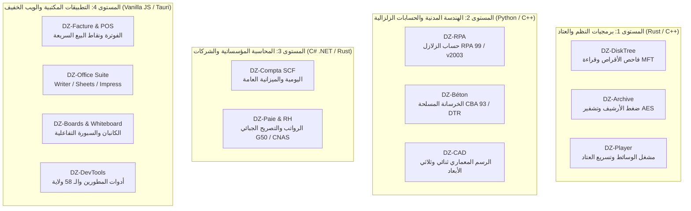

# التصميم الهندسي للمنظومة والمعايير التقنية
## Polyglot Sovereign Architecture & Technical Specifications

> **المبدأ الأساسي: الأداة المناسبة للمهمة المناسبة (The Right Tool for the Right Mission)**  
> لا يمكن حصر كافة البرمجيات في تقنيات الويب، لأن برمجيات فحص العتاد، ضغط الأرشيف، تشغيل الوسائط، الحسابات الهندسية، والمحاسبة المؤسساتية تتطلب بطبيعتها لغات برمجة أصلية (Native Systems Languages) تتصل مباشرة بنظام التشغيل والمعالج وكرت الشاشة وقواعد البيانات.

---

### 1. المستويات التقنية الأربعة للمنظومة (The 4 Architectural Tiers)



---

### 2. تفصيل خيارات لغات البرمجة بحسب طبيعة كل مشروع

#### 🟢 المستوى الأول: برمجيات النظم، الذاكرة، وقراءة العتاد المباشرة (**Rust & C++**)
* **التطبيقات:**
  - `dz-disk-tree` (فاحص الأقراص البديل لـ WizTree)
  - `dz-archive` (أداة الأرشفة والضغط البديلة لـ WinRAR / 7-Zip)
  - `dz-player` (مشغل الوسائط البديل لـ VLC)
* **اللغات المعتمدة:** **Rust** (أساسي) و **C++20** (لواجهات الرسوميات Qt والـ Shell Extensions).
* **الأسباب الهندسية:**
  1. **الوصول المباشر لنظام الملفات:** قراءة جدول الملفات الرئيسي **NTFS Master File Table ($MFT)** عبر Win32 API المباشرة (`FSCTL_GET_NTFS_VOLUME_DATA`) لفحص ملايين الملفات في أقل من 5 ثوانٍ، وهو ما يستحيل على متصفحات الويب القيام به.
  2. **استغلال تعليمات المعالج (AVX2 / SIMD):** ضغط وفك ضغط خوارزميات LZMA2 و Zstd بسرعات فائقة تتجاوز 1.5 جيجابايت/ثانية.
  3. **الاندماج مع نظام التشغيل:** إضافة خيارات كليك يمين (Windows Shell Context Menu) لضغط الملفات وفتحها فورياً.
  4. **تسريع عتاد كرت الشاشة الحقيقي (Hardware Acceleration):** فك تشفير الفيديو عبر DXVA2 / Direct3D 11 Video / VA-API واستخدام مكتبات FFmpeg الأصلية.
  5. **حجم واستهلاك خفيف جداً:** ملف تنفيذي بحجم أقل من 1 ميجابايت واستهلاك ذاكرة RAM أقل من 15 ميجابايت.

---

#### 🟢 المستوى الثاني: الهندسة المدنية، التحليل الإنشائي، والـ CAD (**Python & C++**)
* **التطبيقات:**
  - `dz-rpa` (محرك الحسابات الزلزالية وفق المعيار الجزائري RPA 99 / Version 2003)
  - `dz-beton` (حسابات الخرسانة المسلحة وفق DTR B.C. 2.41 / CBA 93)
  - `dz-cad` (برنامج الرسم الهندسي DWG/DXF بديل AutoCAD)
* **اللغات المعتمدة:** **Python** (للخوارزميات العلمية والمعادلات وحساب المصفوفات بـ NumPy / SciPy) و **C++** (لمحركات الرسم ثلاثي الأبعاد بـ OpenCASCADE / Vulkan).
* **الأسباب الهندسية:**
  1. **الحسابات المصفوفية المعقدة (FEM Matrix Solving):** حل مصفوفات العناصر المنتهية الكبيرة وحساب الترددات الذاتية للأبراج والمنشآت.
  2. **المطابقة التنظيمية الصارمة مع اللوائح الجزائرية:** سهولة تدقيق وتحديث كود المعادلات المعيارية لمركز CGS (RPA 99/v2003, CBA 93, DTR).
  3. **إمكانية الاستخدام كـ CLI ومكتبات برمجية:** إتاحة استخدام المحرك الهندسي لطلاب كليات الهندسة (البليدة، بومرداس، USTHB، باب الزوار، وهران) في أبحاثهم ومشاريع تخرجهم.

---

#### 🟢 المستوى الثالث: المحاسبة المؤسساتية، الأجور، وتصريحات SCF (**C# .NET / Avalonia & Rust/Tauri**)
* **التطبيقات:**
  - `dz-compta` (النظام المحاسبي المالي الجزائري SCF - بديل PC Compta / DLG)
  - `dz-paie` (إدارة الأجور وعلاقات العمل وتصريحات CNAS و G50)
* **اللغات المعتمدة:** **C# (.NET 10 / Avalonia UI / WPF)** أو **Rust + SQLite**.
* **الأسباب الهندسية:**
  1. **التوافق التام مع البيئة المكتبية السائدة في الشركات الجزائرية:** نظام Windows هو البيئة المهيمنة بنسبة 99% في مكاتب المحاسبة والمالية والجمارك والضرائب.
  2. **قواعد بيانات مدمجة سريعة (Embedded SQLite / PostgreSQL):** حفظ القيود المحاسبية، اليوميات، وموازين المراجعة محلياً دون الحاجة لخوادم معقدة.
  3. **دقة الأرقام المالية (Fixed-point Decimal Arithmetic):** تجنب أخطاء الفاصلة العائمة (Floating Point Inaccuracies) عبر النوع الأصلي `decimal` في C#.
  4. **الطباعة الرسمية المعيارية:** التوليد المباشر للدفاتر المحاسبية القانونية، موازين المراجعة، والتصريح الجبائي الشهري G50.

---

#### 🟢 المستوى الرابع: برمجيات الويب، المحررات، والواجهات التشاركية (**Vanilla JS / TypeScript + Tauri**)
* **التطبيقات:**
  - `dz-facture` (نقاط البيع السريعة POS والفوترة التجارية المحمولة)
  - `dz-word`, `dz-calc`, `dz-slides` (الحزمة المكتبية الوطنية)
  - `dz-boards` (لوحات كانبان للمشاريع التشاركية)
  - `dz-whiteboard` (السبورة البيضاء للشاشات التفاعلية والجامعات)
  - `dz-devtools` (منصة المطورين والـ 58 ولاية)
* **اللغات المعتمدة:** **Vanilla JavaScript (ES Modules) / TypeScript + HTML5 Canvas + Modern CSS**، مع إمكانية تغليفها بمحرك **Tauri (Rust)** كبرامج مكتبية خفيفة.
* **الأسباب الهندسية:**
  1. **العمل عبر الشبكة المحلية (Local LAN & Wi-Fi):** إمكانية فتح نقطة بيع أو كاشير على الحاسوب والاتصال بها من هواتف وتابلت العمال في المحل دون إنترنت.
  2. **تجربة مباشرة وسريعة عبر المتصفح:** إتاحة تجربة المنظومة فوراً عبر GitHub Pages بنقرة واحدة (Try Now).
  3. **الحياد التام للأجهزة:** تعمل على أي نظام تشغيل (Windows, Linux, macOS, Android) بأقل جهد صيانة.

---

### 3. خريطة توزيع المشاريع في المستودع

```
algerie-open-source/
├── apps/
│   ├── business-enterprise/
│   │   └── dz-facture/          # Web / POS / Local LAN
│   ├── productivity/
│   │   ├── dz-disk-tree/        # Web Demo + native-rust/ (Rust CLI & Fast MFT Engine)
│   │   └── dz-archive/          # Web Demo + native-rust/ (Rust Multi-Threaded Compression)
│   ├── multimedia/
│   │   └── dz-player/           # Web Demo + native-cpp/ (C++ / Qt & FFmpeg Core)
│   ├── engineering/
│   │   ├── dz-rpa/              # Python Native Seismic Engine (RPA 99 / v2003)
│   │   ├── dz-beton/            # Reinforced Concrete DTR B.C. 2.41 / CBA 93
│   │   └── dz-cad/              # CAD 2D/3D DWG/DXF Viewer & Engine
│   ├── finance-accounting/
│   │   ├── dz-compta/           # C# (.NET 10) SCF Ledger & Balance Générale
│   │   └── dz-paie/             # Algerian Payroll & Social CNAS Declarations
│   ├── education-academia/
│   │   └── dz-whiteboard/       # Interactive Whiteboard (Web Canvas + Desktop)
│   ├── office-suite/
│   │   ├── dz-word/             # Word Processor & Ministerial Templates
│   │   ├── dz-calc/             # Tax Spreadsheet & Tafqit Engine
│   │   ├── dz-slides/           # Presentation Studio & Laser Pointer
│   │   └── dz-pdf/              # PDF Studio & Official Administrative Seals
│   ├── collaboration/
│   │   └── dz-boards/           # Kanban Project Management
│   └── developer-tools/
│       └── dz-devtools/         # 58 Wilayas API, Validators, & Dev Studio
```

---

### 4. خاتمة الرؤية الهندسية
بهذه المعمارية المتعددة اللغات، تضمن **المنظومة الجزائرية للبرمجيات المفتوحة المصدر**:
- **أعلى أداء ممكن** للبرمجيات الحساسة للعتاد وسرعة القراءة والضغط والرسوميات.
- **أقصى مرونة وسهولة وصول** للبرمجيات الإدارية والمكتبية والتجارية.
- **فتح الباب لكافة المطورين الجزائريين** بمختلف تخصصاتهم ولغاتهم المفضلة (Rustaceans, Pythonistas, C# .NET Developers, C++ Engineers, and Web Craftsmen) للمساهمة في بناء استقلال الجزائر الرقمي.
