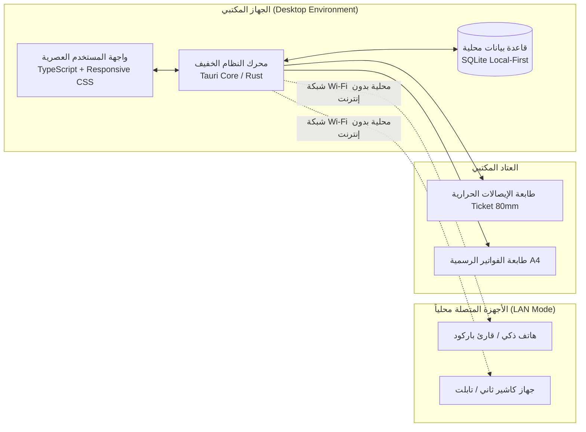

# ️ التصميم الهندسي للمنظومة والمعايير التقنية
## System Architecture & Technical Specifications

تم اختيار المعمارية التقنية بعد دراسة دقيقة لواقع البنية التحتية للأجهزة وشبكات الاتصال في الجزائر (في المحلات التجارية، الشركات، والمكاتب الإدارية).

---

### 1. الركائز الهندسية الأربع للمنظومة

---

### 2. لماذا هذا الاختيار هو الأفضل للبيئة الجزائرية؟

#### 2.1 محرك سطح المكتب الخفيف (**Tauri** بدلاً من **Electron**):
* **حجم البرنامج:** حجم ملف التثبيت أقل من **15 ميغابايت** (مقارنة بـ 150-250 ميغابايت في إلكترون).
* **استهلاك الذاكرة (RAM):** يستهلك حوالي **30 إلى 50 ميغابايت** فقط، ما يجعله يعمل بسلاسة فائقة حتى على الحواسيب المكتبية القديمة والمتواضعة المنتشرة بكثرة في المحلات والمصالح الإدارية.
* **الأمان والسرعة:** مبني بلغة Rust ذات الأداء العالي وحماية الذاكرة.

#### 2.2 قاعدة البيانات المحلية الخالية من التعقيد (**Embedded SQLite**):
* **صفر إعدادات (Zero-Config):** لا يحتاج التاجر أو الموظف لتثبيت خوادم معقدة مثل MySQL أو SQL Server ومشاكل المنافذ والخدمات المتوقفة.
* **النسخ الاحتياطي السريع (Flash Disk Backup):** قاعدة البيانات عبارة عن ملف واحد محلي يمكن نسخه بسهولة على فلاش ديسك بضغطة زر واحدة لحماية بيانات التاجر.
* **السرية التامة للبيانات:** بيانات المبيعات والأرباح والعملاء محفوظة 100% محلياً على جهاز المستخدم ولا تُرفع إلى أي خوادم خارجية غير مرغوبة.

#### 2.3 قابلية التوسع والمشاركة عبر الشبكة المحلية (**Local Wi-Fi Mode**):
* يمكن للبرنامج فتح منفذ محلي (Local HTTP Server) يتيح ربط هاتف التاجر أو لوحة إلكترونية (Tablet) كقارئ باركود محمول أو شاشة استعراض مخزون للموظفين داخل المحل دون الحاجة لأي اشتراك إنترنت خارجي.

#### 2.4 الطباعة المتعددة (Hardware Support):
* دعم الطباعة القياسية **A4 / A5** للفواتير الرسمية والتقارير الشهرية.
* دعم بروتوكول **ESC/POS** لطابعات الإيصالات الحرارية (Ticket de caisse 80mm / 58mm) وصناديق النقد (Cash Drawers) عبر USB أو Bluetooth.

---

### 3. معايير كتابة الكود والتصميم (Design Principles)
* **دعم RTL و LTR المزدوج:** يتم تصميم كل واجهة لتدعم التبديل الفوري بنقرة واحدة بين الواجهة العربية (RTL) والواجهة الفرنسية (LTR).
* **تصميم راقٍ ومريح للعين:** استخدام خطوط واضحة وعصرية (مثل خط Cairo أو Readex Pro للعربية، و Inter للفرنسية) مع دعم الوضع الليلي (Dark Mode) لراحة التجار الذين يقضون ساعات طويلة أمام الشاشات.
* **استقلالية الحزم (Modular Packages):** حزم المنطق المشترك (التفقيط، الضرائب، الولايات) منفصلة تماماً ويمكن استخدامها في تطبيقات ويب أو موبايل أخرى.
