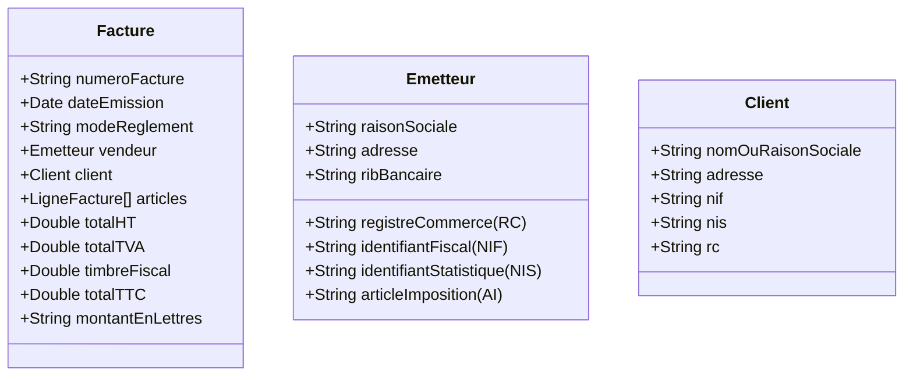

# 🇩🇿 الدليل القانوني والجبائي للفوترة في الجزائر
## Algerian Legal & Fiscal Invoicing Standards

---

### 1. الإطار التشريعي
تخضع الفوترة في الجزائر لمجموعة من النصوص القانونية، أبرزها:
* **القانون رقم 04-02** المحدد للقواعد المطبقة على الممارسات التجارية.
* **المرسوم التنفيذي رقم 05-468** المحدد لشروط تحرير الفاتورة وسند التسليم ووصل البيع.
* **قانون الضرائب المباشرة والرسوم المماثلة** و**قانون الرسوم على رقم الأعمال**.

---

### 2. البيانات الإلزامية في الفاتورة الجزائرية (Mentions Obligatoires)

لكي تكون الفاتورة صحيحة ومعتمدة ومقبولة جبائياً، يجب أن تحتوي على البيانات الآتية:



#### 2.1 بيانات البائع/المؤسسة (L'Émetteur):
1. **الاسم التجاري أو التسمية الاجتماعية (Raison Sociale / Nom commercial)**.
2. **العنوان الجغرافي للمقر أو المحل (Adresse du siège)**.
3. **رقم السجل التجاري (Numéro du Registre de Commerce - RC)**: يتكون عادة من رمز الولاية، نوع السجل (A للأشخاص الطبيعيين، B للشركات)، ورقم التسجيل.
4. **رقم التعريف الجبائي (Numéro d'Identification Fiscale - NIF)**: يتكون من 15 رقماً إجبارياً.
5. **رقم التعريف الإحصائي (Numéro d'Identification Statistique - NIS)**: يتكون عادة من 20 رقماً.
6. **رقم المادة الضريبية (Article d'Imposition - AI)**: رقم بطاقة التعريف الجبائية الخاصة بالنشاط.
7. **الحساب البنكي أو البريدي (RIB / RIP)** لتسهيل المعاملات غير النقدية.

#### 2.2 بيانات العميل (Le Client):
* إذا كان العميل شركة أو تاجراً: يجب ذكر نفس البيانات (الاسم، العنوان، NIF، NIS، RC، AI).
* إذا كان العميل مستهلكاً نهائياً (Particulier): يذكر الاسم والعنوان، ويمكن استخراج وصل بيع (Bon de vente / Ticket de caisse) بدلاً من فاتورة كاملة.

#### 2.3 بيانات المعاملة:
* **رقم تسلسلي للفاتورة (Numéro de facture):** متسلسل سنوياً ودون فراغات أو تكرار.
* **تاريخ الإصدار وتاريخ الاستحقاق.**
* **جدول تفصيلي للسلع والخدمات:** التعيين الدقيق، الوحدة، الكمية، السعر الأحادي الخام (P.U HT)، التخفيضات (Remises)، ومعدل الضريبة (TVA).
* **طريقة الدفع (Mode de règlement):** نقداً (Espèces)، شيك، تحويل بنكي، أو كمبيالة.

---

### 3. الحسابات الضريبية والمالية (Calculs Fiscaux)

```
+--------------------------------------------------------------+
| 1. المجموع بدون رسوم (Montant Total HT)                       |
|    = ∑ (الكمية × السعر الأحادي) - التخفيضات                    |
|                                                              |
| 2. الرسم على القيمة المضافة (TVA):                            |
|    - المعدل المخفض: 9% (للمواد الأولية والغذائية المدعمة)      |
|    - المعدل العادي: 19% (لأغلب السلع والخدمات)                 |
|                                                              |
| 3. رسم الطابع الجبائي (Droit de Timbre Fiscal):              |
|    - يطبق حصراً في حالة الدفع نقداً (Paiement en Espèces)    |
|    - المعدل المعمول به: 1% من المبلغ الإجمالي شامل الرسم      |
|    - مع مراعاة الحد الأدنى والحد الأقصى القانوني               |
|                                                              |
| 4. المجموع الكلي شامل كل الرسوم (Total TTC):                 |
|    = Total HT + TVA + Timbre Fiscal                          |
+--------------------------------------------------------------+
```

---

### 4. التفقيط القانوني (Montant en Toutes Lettres)
القانون الجزائري يلزم بأن ينتهي أسفل الفاتورة بعبارة صريحة تؤكد المبلغ بالحروف:
> *"Arrêtée la présente facture à la somme de : [المبلغ بالحروف] Dinars Algériens."*  
> *"أوقفت هذه الفاتورة عند مبلغ وقدره: [المبلغ بالحروف] ديناراً جزائرياً."*

---

### 5. دورة المستندات التجارية (Commercial Documents Cycle)

1. **عرض الأسعار (Devis / Facture Proforma):** وثيقة غير ملزمة محاسبياً لتقديم عروض الأسعار للزبائن.
2. **سند الطلب (Bon de Commande - BC):** صادر من المشتري لتأكيد الطلبية.
3. **سند التسليم (Bon de Livraison - BL):** يرافق البضاعة أثناء النقل ويوقع عليه المستلم لإثبات استلام السلعة فعلياً.
4. **الفاتورة النهائية (Facture Définitive):** الوثيقة المحاسبية الرسمية ذات الأثر الجبائي والمالي.
5. **فاتورة الإلغاء/التخفيض (Facture d'Avoir):** تستخدم عند إرجاع سلعة أو منح تخفيض لاحق.
